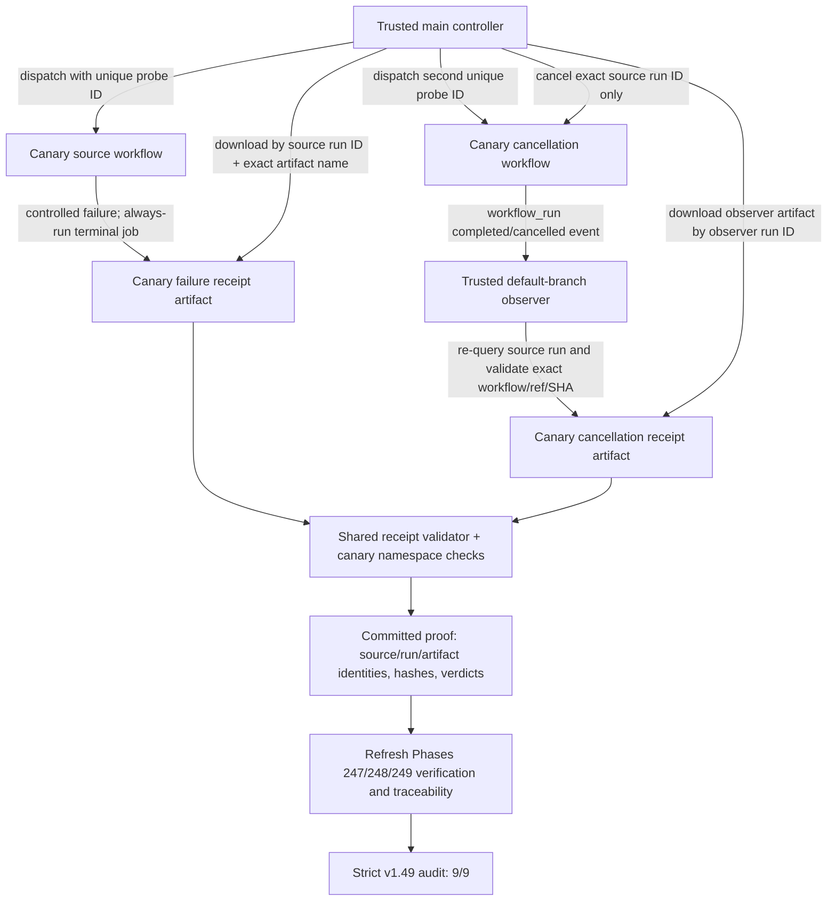

# Phase 250: Close v1.49 audit gaps - Research

**Researched:** 2026-10-10  
**Domain:** Release evidence reconciliation and GitHub Actions terminal-receipt proof  
**Confidence:** HIGH for repository contracts and documented GitHub behavior; MEDIUM for hosted canary feasibility until the exact workflows run on GitHub

<user_constraints>
## User Constraints (from CONTEXT.md)

### Locked Decisions

### Verifier freshness and exact evidence identity
- **D-01:** Treat each canonical phase verification as a snapshot bound to its source and evidence identity, with a captured-at time and references to the exact commits, refs, workflow runs, and artifacts it evaluated. Refresh a stale report from current authoritative evidence; preserve its prior result as history where useful, and never silently substitute a later passing artifact into an older report.
- **D-02:** Phase 247 must be independently verified against one reconciled, approved candidate tuple and its matching readiness ledger, exact-head CI, dry-run, and disposition evidence. The current artifacts disagree: `247-RELEASE-READINESS.json` and `247-VALIDATION.md` bind to candidate `d76d7f2306f6099063a80a420d2d8a4e04c7785f`, while the later `247-10-REBIND-PROPOSAL.json` and Roadmap refer to `0e773d3614a242e4fbcdd34c418ecb8a307703d6`. Reconcile that tuple from immutable evidence before marking READY-01/02 satisfied; if it cannot be proved, leave the requirements unsatisfied. Plan 05's checkpointed recovery path is superseded only where later exact-source evidence proves the same acceptance criteria.
- **D-03:** Refresh Phase 248 verification from the current protected-environment names/policies and hosted exact-source success evidence. Never read or record credential values. AUTO-01 may pass only when the canonical verifier accepts the intended environment scope and exact-source gate; AUTO-02 stays open until both hosted failure and cancellation artifacts have been retained, retrieved, and validated. Local fixtures and the success artifact alone do not prove hosted terminal delivery.
- **D-04:** Refresh Phase 249 verification from the passing `refs/heads/evidence/phase-249-final-acceptance` record, current exact-main CI, public 1.6.0 proof, and clean inventory. Keep package-source SHA `9e80cb78d6374b1ed4074d5fef6b613fee879dca` distinct from final protected-main SHA `08300af1740fea8b77d5928a182688acbf103edc`. Keep the historical HANDOFF loss classified as explicitly accepted with recorded loss; never call the bytes recovered or preserved.

### Safe hosted failure/cancellation canary
- **D-05:** Use a dedicated, explicitly allowlisted canary source workflow on `main` to exercise hosted failure and cancellation receipts without invoking production release/publish jobs. The canary receives no Hex credential, no publishing environment, and no authority to create a release, tag, or merge a PR. Its artifacts must be visibly namespaced as canary evidence and cannot overwrite or masquerade as a production release receipt.
- **D-06:** Exercise the production receipt contract through the same sanitized receipt builder/validator and hosted artifact delivery/retrieval path. The controlled failure run must retain a source-bound failure receipt; an automated controller must cancel only the exact canary run ID for the cancellation case, after which trusted observer code retains a source-bound cancellation receipt. Retrieve both artifacts automatically and validate source workflow identity, run ID/attempt, SHA, conclusion/verdict, observer identity where applicable, required timestamps, and absence of credential-like fields.
- **D-07:** Keep the observer on trusted default-branch code with least-privilege permissions. `workflow_run` workflows can access tokens and secrets even when the source workflow cannot, so the source must not check out, execute, or trust untrusted PR code or artifacts. If the observer accepts a canary source, require its exact workflow identity/path and allowed event/ref; do not weaken the production Release Please identity checks or cancel a real release to manufacture evidence.
- **D-08:** Run the hosted canary and artifact retrieval without human UAT. Keep the hosted trigger/action bounded and reusable on demand; do not add a periodic canary unless planning shows recurring signal is worth its runner cost and operational noise.

### Traceability and closeout
- **D-09:** Keep READY-01/02 assigned to Phase 247, AUTO-01/02 to Phase 248, and REL-01/02 to Phase 249. Phase 250 contributes verification evidence only; it must not claim these requirements as newly implemented or conceal an owner-phase gap with duplicate claims.
- **D-10:** Update phase verification, summary requirement frontmatter, `REQUIREMENTS.md`, and the milestone audit only after the source verifications and hosted canary artifacts agree. Run the strict milestone audit last; 9/9 requires all three source-verification reports to pass and no orphaned or contradictory traceability rows.

### the agent's Discretion
- Choose the smallest canary/controller workflow structure that isolates the production path, uses only the GitHub permissions needed to dispatch/cancel the canary, and never receives Hex publish credentials.
- Choose canary artifact names, test-only receipt markers, and the deterministic download/validator command while preserving the established receipt schema and production artifact identity.
- Choose the exact verification refresh order and the smallest regression check that prevents these reports from drifting again. Keep any reusable audit-tool redesign or unrelated maintenance outside this phase.
- Use one CI watcher per run, 60-second polling, and structured artifact/run summaries; retrieve failed logs only for failed runs and honor the GitHub API rate-limit stop rule.

### Deferred Ideas (OUT OF SCOPE)

- A generalized cross-milestone verification freshness service or redesign of GSD audit tooling is outside the fixed Phase 250 boundary; add only a narrow regression check needed to protect this closeout.
- Weekly/scheduled release-receipt canaries are deferred unless the plan demonstrates durable recurring value beyond on-demand automated proof.
- Any new auth, Phoenix UI, documentation, or release features remain outside this audit-closure phase.

### Folded Todos
None. The phase-matcher produced broad heuristic matches; the directly related Release Please note-placement and release-label items are already handled in Phases 247/248, and the other canary/verifier items describe separate or historical work. Do not expand Phase 250 with unrelated backlog items.
</user_constraints>

<phase_requirements>
## Phase Requirements

| ID | Description | Research Support |
|----|-------------|------------------|
| READY-01 | The 1.6.0 release candidate's package metadata, manifest, changelog, tag, and HexDocs source reference agree; adopter notes accurately describe shipped changes, compatibility, required generated-host action or no action, and the `~> 1.6.0` update/check path. Final local Hex dry-run remains blocked by unavailable candidate locked dependencies. | Reconcile one approved immutable candidate tuple, then bind its matching readiness ledger, exact-head CI, dry-run, package metadata, and adopter evidence before canonical verification. |
| READY-02 | Every open PR at readiness time has a recorded release-blocking, release-relevant, or separate-follow-up disposition; inherited checkout changes are preserved and dispositioned; release work proceeds from a clean source checkout without silently absorbing unrelated work. Final evidence capture remains blocked with Plan 04. | Use the final readiness/disposition ledger and validator, not plan completion alone; independently verify PR and inherited-work evidence. |
| AUTO-01 | Before release package work starts, the release tag is proven to resolve to the exact Release Please source SHA whose required CI gate passed; the existing test, warning-free docs, package-content, and Hex dry-run checks run against that immutable source. Active release evaluation is not cancelled, workflow permissions are scoped, and the Hex secret is available only to the final publish step. | Name-only protected-environment evidence plus exact-source hosted gate; never read or record secret values. |
| AUTO-02 | The release lane retains machine-readable gate and publish receipts for both success and failure, linking version/tag, source SHA, workflow/run identity, verdict, relevant URLs, attempts/timestamps, and failure or cancellation state. | Dedicated no-publish canary, trusted observer, cross-run artifact retrieval, exact identity validator, and durable captured artifacts; hosted evidence is mandatory. |
| REL-01 | Hex contains package version 1.6.0 built from the gated source, and live checks prove the versioned HexDocs and source reference resolve to the same release. | Use the authoritative evidence ref and public proof; keep package-source SHA separate from final-main SHA. |
| REL-02 | The final protected-main release commit has green required CI, the release receipt is committed and points to that exact source, every local worktree is clean, and every open PR has a recorded disposition. | Use final-main proof and terminal acceptance evidence; preserve accepted-loss wording exactly. |
</phase_requirements>

## Summary

Phase 250 is an evidence-reconciliation phase with one genuine hosted observability gap. The correct approach is to independently refresh Phase 247, 248, and 249 verification records from their authoritative evidence, then update each phase summary/requirements status and run the strict milestone audit once as the final gate. Phase 247's two candidate SHAs are materially different snapshots; the existing evidence does not permit selecting one by recency or prose alone. Plan 247-10 explicitly made any rebind contingent on separate authorization, and its proposal remains `authorization_status: pending`; the verifier must inspect durable approval evidence before accepting the child candidate. Resolve the approved candidate tuple from immutable commit/blob/run evidence or leave READY-01/02 unsatisfied. The `REQUIREMENTS.md` READY-01 sentence also still calls the final dry run blocked by missing candidate dependencies, while the later readiness evidence reports a successful authenticated non-publishing dry run on the parent candidate; keep the historical local blocker distinct from that hosted result. Phase 249 has a later passing final-acceptance record on `refs/heads/evidence/phase-249-final-acceptance`, while the checked-in JSON and canonical verification report are stale; that report must point to the evidence-ref object and distinguish package source from protected main.

For AUTO-02, use a manual/on-demand controller that dispatches one isolated failure probe and one isolated cancellation probe from trusted `main`, captures each returned source run ID, and automatically retrieves and validates each artifact. The failure probe should let its own trusted terminal job write the failure receipt; the cancellation probe should be cancelled by the controller only after the exact run reaches its explicit wait point, then rely on a trusted completion observer for the cancellation receipt. This exercises the hosted event/artifact path without a production release, Hex environment, publish secret, tag, or PR merge. A hosted pass is required; shell fixtures, workflow contracts, and the already-proven success artifact establish only local contracts and success-path behavior.

**Primary recommendation:** split the work into independently verifiable owner-phase refreshes, a separate-source canary plus trusted observer/retrieval controller, then a final traceability/audit closeout. Keep each report bound to current immutable source and evidence identities, fail closed on unresolved provenance, and commit machine-readable evidence before recording 9/9.

## Architectural Responsibility Map

| Capability | Primary Tier | Secondary Tier | Rationale |
|------------|-------------|----------------|-----------|
| Phase 247/248/249 evidence reconciliation | Repository evidence / GSD verifier | GitHub Actions and API | Canonical reports and requirement rows are repository state; source identity and hosted outcomes come from authoritative GitHub records. |
| Controlled failure receipt | GitHub Actions canary source workflow | Shared shell receipt builder and artifact service | The source workflow must execute on hosted Actions to prove real upload and run binding; the established helper owns receipt sanitation and schema validation. |
| Cancellation receipt | Trusted default-branch `workflow_run` observer | Actions API and artifact service | The observer runs after the source concludes and independently confirms source identity/conclusion before upload. |
| Canary orchestration and retrieval | GitHub Actions controller | Actions REST API / GitHub CLI | The controller owns unique correlation, exact-run cancellation, cross-run retrieval, and final fixture/receipt validation. |
| Requirements/milestone closeout | Planning repository | GSD audit tooling | Update original owner rows only after refreshed verifications pass; strict audit is the final consistency check. |

## Standard Stack

### Core

| Tool | Version | Purpose | Why Standard |
|------|---------|---------|--------------|
| Existing GitHub Actions workflows and `workflow_dispatch` / `workflow_run` | Existing repository contracts; no new package | Isolated hosted fault injection, trusted observer, and receipt retrieval | Matches the repository's established Release Please, observer, artifact, and CI conventions. [VERIFIED: `.github/workflows/release-please.yml:577-674`; `.github/workflows/release-run-observer.yml:1-42`] |
| Bash + `jq` | Existing repo scripts | Build/validate sanitized source-bound receipt projections and exercise fail-closed shell contracts | Reuse the current receipt/observer helpers and fixture suites; adding a new runtime would widen the audit surface. |
| `gh` / GitHub Actions REST API | Current GitHub-hosted source of run/artifact identity | Dispatch runs, cancel the exact canary run, query metadata, retrieve artifacts | The controller needs authoritative IDs and artifact retrieval, not a third-party release service. Official APIs return a run ID for dispatch and cancel a named run ID. [CITED: GitHub REST workflows](https://docs.github.com/en/rest/actions/workflows), [CITED: GitHub REST workflow runs](https://docs.github.com/en/rest/actions/workflow-runs) |
| Existing `actionlint`, shell fixtures, ExUnit workflow-contract tests, and Node closeout validator | Versions already pinned/available in repo | Validate workflow syntax, helper invariants, exact identities, and audit evidence | Matches Phase 248/249 validation architecture; no package install is indicated. |

### Alternatives Considered

| Instead of | Could Use | Tradeoff |
|------------|-----------|----------|
| Dedicated non-publishing canary source + trusted observer | Cancel a real Release Please run | Rejected: manufactures disruption in production release automation and can interrupt a real release. |
| Hosted canary plus automatic retrieval | Local fixtures only | Rejected for AUTO-02: cannot prove GitHub trigger expressions, hosted artifact upload/retention, observer event delivery, or cross-run retrieval. |
| Exact workflow/run/artifact identity | Latest run by branch or artifact name alone | Rejected: concurrent dispatches/retries can race; names and branch are not unique provenance. |
| Separate canary observer identity/allowlist while preserving production checks | Broaden production observer to accept arbitrary workflow runs | Rejected: weakens the production source trust boundary and increases privileged-trigger exposure. |
| On-demand canary invocation | Weekly scheduled canary | No recurring schedule: user context explicitly defers it absent demonstrated ongoing value; it adds runner cost and operational noise. |

No external package is installed or required by the recommended approach; Package Legitimacy Audit is not applicable.

## Architecture Patterns

### Data flow



### Recommended implementation shape

Use the smallest safe topology with three workflow roles: an on-demand controller, one explicit canary source workflow with typed scenario inputs, and a trusted completion observer. The controller dispatches the source using an API call that returns the source run ID, rather than finding “the newest run”; pass a random/caller-generated probe identifier and bind it to a unique run name, exact workflow path/ID, `main` ref, event, full head SHA, run attempt, and creation time. Its permissions should be limited to Actions read/write for dispatch, run metadata, exact-run cancellation, and artifact retrieval; it needs no contents write, packages write, deployment, or Hex/publish environment. The canary source gets no secrets or environment at all. The observer retains only the read permissions needed to re-query the source run and upload its artifact.

For the failure case, inject a deterministic failure in a clearly test-only canary gate before any production code or credential-bearing step. An `always()` terminal job should build the sanitized receipt with the shared production receipt helper/validator and upload it under a unique canary artifact name, even though the canary run conclusion is failure. Mark the receipt unambiguously as canary evidence (test-only marker and canary workflow identity); do not call it a production Release Please failure or allow it to occupy the production artifact name. The current helper validates production-style version/tag/SHA identities and its accepted failure stages are a finite enum. If that contract needs a test-only extension, make the canary identity explicit and test both directions: the canary validator accepts only canary-marked receipts, while production receipt validation rejects canary identity/fields and continues to accept only its current production workflow contract. Do not add a broad “any workflow” exception.

For cancellation, dispatch a distinct canary run that reaches a bounded, explicit wait step; the controller waits until the authoritative API reports that exact run is in progress at the expected stage, then sends ordinary cancel for that returned run ID. Do not cancel by branch, workflow name, latest run, or shared concurrency group; do not use force-cancel to bypass terminal jobs. The trusted observer should be separately identifiable or use a narrowly explicit allowlist for the exact canary workflow ID/path in a canary branch of its contract, while retaining the production Release Please match unchanged. Observer logic should query the Actions API and compare repository, workflow ID/name/path, event, branch/ref, run ID, attempt, full SHA, conclusion, and timestamps; it must not checkout source SHA, execute source scripts/artifacts, or trust downloaded files. The observer uploads the cancellation receipt to a distinct, run-bound artifact namespace.

The controller downloads each artifact by the exact source/observer run ID, not by an unqualified artifact name. Download to a temporary directory outside the checkout; parse constrained JSON and run the receipt and canary-namespace validators without executing artifact contents. Capture artifact ID, exact name, producer run/attempt, upload digest or downloaded SHA-256, retrieval time, and retention/expiry metadata where available. GitHub's artifact download action verifies its SHA-256 digest and reports a mismatch as a warning; treat a mismatch as failure in the controller rather than ignoring it. Upload with a retention duration within repository/organization policy and retrieve immediately in the same controller run. Commit the validation proof and enough sanitized receipt fields to the Phase 250 evidence record so later audit does not depend on a live runner workspace.

### Verifier and audit ordering

1. Preflight all immutable refs/blobs and workflow/run/artifact identities before changing canonical verification files. For Phase 247, the readiness ledger/validation bind `d76d7f…`, while the proposal introduces `0e773d…` as a child with one changed Playwright file and exact-head CI. Read the proposal, commit ancestry, manifest/source blob identities, and hosted run metadata together; do not infer which tuple the plan intended from the latest roadmap line. If all acceptance inputs cannot be joined to one approved tuple, leave READY requirements open and produce a diagnostic.
2. Refresh the Phase 247 verifier and summary requirements only after the candidate tuple and readiness/disposition evidence are joined. Plan 05 remains checkpointed; its incomplete tasks stay recorded as superseded only where later exact evidence covers the same criterion.
3. Build and run the canary locally first: shell fixture tests, receipt helper tests, observer tests, workflow contract tests, and `actionlint`. Then dispatch the two hosted probes and validate retrieved artifacts. Hosted artifacts—not fixture output—are the AUTO-02 acceptance evidence.
4. Refresh Phase 248 canonical verification using current environment name/policy evidence and existing exact-source success evidence plus the two new hosted artifacts. Never read or record secret values. If any artifact is absent, expired, misbound, or malformed, retain the truthful blocked/partial verifier.
5. Refresh Phase 249 canonical verification from the passing evidence ref, current main proof/CI, public release receipt, current clean inventory, and preservation record. Preserve the distinction between published package source SHA and final protected main SHA; keep the historical HANDOFF loss explicitly classified as accepted loss.
6. Only when each owner verification passes, synchronize its summary `requirements-completed`, `REQUIREMENTS.md` checkboxes/status, and traceability row without duplicating ownership into Phase 250. Run the strict milestone audit last. Its requirement score, phase verification, summary frontmatter, and zero-orphan/zero-contradiction result must all agree at 9/9.

### State of the art and lessons

GitHub's current contract is that `workflow_run` completion fires independent of the source conclusion and runs from default-branch workflow code; that receiver can access secrets and write tokens even if the source did not. Therefore the trigger is appropriate for a privileged observer only when the observer treats the source as data, checks authoritative API metadata, and never runs source code or trusts its artifacts. Cross-run downloads require a token and run ID. Artifact retention cannot exceed the repository/organization/enterprise limit. Artifact uploads are immutable in current v4 behavior; use unique names per source run/attempt rather than relying on overwrite. A `workflow_run` receiver must exist on the default branch and should use the `completed` activity to see both failed and cancelled conclusions. [CITED: GitHub workflow events](https://docs.github.com/en/actions/reference/workflows-and-actions/events-that-trigger-workflows), [CITED: secure use](https://docs.github.com/en/actions/reference/security/secure-use), [CITED: artifact storage and retrieval](https://docs.github.com/en/actions/tutorials/store-and-share-data)

The Release Please→CI gate→Hex lane and its source-bound receipt are already the intended system. Keep the canary as a narrow probe into its receipt contract and artifact plumbing, not as a second publisher, alternate release path, or general release framework. The checked-in prompts favor least privilege, pinned actions, separate publishing credentials, exact-source checks, source-linked machine-readable receipts, and contributor-friendly automation; the present workflow already applies those ideas with per-run concurrency groups and `cancel-in-progress: false`. Reuse those conventions. [VERIFIED: `prompts/elixir-oss-lib-ci-cd-best-practices-deep-research.md`]; [VERIFIED: `prompts/elixir-opensource-libs-best-practices-deep-research.md`]

GitHub concurrency is not a safe run-correlation mechanism: a group allows at most one running run, and a newly queued run may replace/cancel its pending sibling unless queue behavior is chosen explicitly. Do not place the canary controller or source in a production concurrency group. Use unique probe IDs and unique non-cancelling groups, while having the controller explicitly cancel only its exact source run. The artifact tutorial explicitly describes v4 uploads as immutable; use distinct run-and-attempt names so this proof does not rely on same-name overwrite behavior. [CITED: GitHub workflow concurrency](https://docs.github.com/en/actions/how-tos/write-workflows/choose-when-workflows-run/control-workflow-concurrency), [CITED: GitHub artifact storage](https://docs.github.com/en/actions/tutorials/store-and-share-data)

## Don't Hand-Roll

| Problem | Don't Build | Use Instead | Why |
|---------|------------|-------------|-----|
| Receipt schema and credential filtering | An unvalidated `jq`/YAML dump of job contexts or raw logs | `scripts/ci/release-receipt.sh` and its shell fixtures, with narrow test-only canary metadata | The existing helper checks source, run, verdict/stage consistency, timestamps, and credential-shaped keys, then atomically persists the projection. |
| Cancellation correlation | Trusting `workflow_run` payload fields alone | `scripts/ci/release-observer.sh`'s authoritative API re-query pattern, with a separately exact canary identity contract if required | Event payload is a locator; source identity and conclusion must be confirmed against the API. |
| GitHub artifact retrieval | Fetching the latest artifact globally or parsing artifact contents as executable scripts | Actions artifact API/download action with exact source run ID and unique name; JSON-only validator in `$RUNNER_TEMP` | Cross-run retrieval needs explicit token/run binding; artifacts are untrusted data and can be hostile. |
| Phase closeout | Hand-editing a 9/9 score or inferring completion from plan summaries | Canonical owner-phase verification files and strict milestone audit | Audit requires all original owners to pass and matching requirement mapping; evidence gaps are not waived. |

**Key insight:** distinguish evidence producer, trusted verifier, and artifact consumer. Each should attest only the part it can observe. Local tests prove schema/control logic; GitHub itself must prove event delivery, artifact upload, retention, and retrieval.

## Common Pitfalls

### Letting the failure test prevent the receipt upload
**What goes wrong:** The expected nonzero step marks the source job failed and normal downstream steps are skipped. A cancellation can terminate the workflow before its own `always()` receipt/upload job completes.  
**How to avoid:** For failure, isolate the injected failing step from a terminal `always()` receipt job, and assert it ran. For cancellation, use the external trusted observer after source completion; never depend on the cancelled source to upload its own final artifact. GitHub documents that `always()` conditions can continue through ordinary cancellation, but hard/force cancellation can bypass them. [CITED: workflow cancellation reference](https://docs.github.com/en/actions/reference/workflows-and-actions/workflow-cancellation)

### Treating a privileged observer as harmless
**What goes wrong:** `workflow_run` has access to secrets/write tokens and an untrusted artifact can be used for code execution or data poisoning.  
**How to avoid:** Keep observer workflow on `main`, use read-only permissions, exact source workflow ID/path/event/ref allowlists, no source checkout, no artifact execution, and a constrained JSON projection. [CITED: GitHub secure use](https://docs.github.com/en/actions/reference/security/secure-use)

### Cancelling the wrong run or losing the cancellation signal
**What goes wrong:** A “latest run” query races with retries or concurrent dispatches; shared concurrency groups can replace queued probes; broad cancellation can interrupt production; force-cancel may skip `always()` jobs.  
**How to avoid:** Use dispatch response's exact run ID plus unique probe ID; verify current workflow identity, branch, SHA, attempt, and expected in-progress stage immediately before the normal cancel call. Refuse cancellation on any mismatch. Keep probe concurrency unique and non-cancelling. Do not use force-cancel. [CITED: GitHub workflow REST API](https://docs.github.com/en/rest/actions/workflows), [CITED: cancellation API](https://docs.github.com/en/rest/actions/workflow-runs), [CITED: concurrency](https://docs.github.com/en/actions/how-tos/write-workflows/choose-when-workflows-run/control-workflow-concurrency)

### Using a “canary” receipt that is indistinguishable from a production release
**What goes wrong:** A test receipt can be mistaken for a release, pass production contract checks using fake stage semantics, or overwrite an artifact/report with the production name.  
**How to avoid:** Namespace artifact and JSON marker, bind the actual canary source workflow/run/SHA and observer run, and require the production validator to reject canary markers. Do not map the injected failure to a misleading production failure stage; use a named test-only stage or an explicitly modeled canary envelope with fixtures.

### Assuming an upload proves retrieval or durable evidence
**What goes wrong:** Workflow upload succeeds, but cross-run permissions, artifact identity, retention policy, expiration, or download parsing fail. An uncommitted runner file disappears with the job.  
**How to avoid:** Download by run ID and exact artifact name, validate digest and all identity fields, record artifact IDs/URLs/digests/captured-at, and persist a sanitized proof artifact in the phase closeout. Verify requested retention is within live repository limits and retrieve artifacts before expiry. [CITED: GitHub artifact storage](https://docs.github.com/en/actions/tutorials/store-and-share-data)

### Silently repairing stale source reports or requirement status
**What goes wrong:** A newer passing artifact is substituted into an old verifier, or a requirement status is marked complete before its owner verification and summary agree.  
**How to avoid:** Bind each refreshed verifier to the exact source/evidence refs and capture time; preserve the old result as history when useful. Run the final audit only after all three owner reports, their summary frontmatter, and `REQUIREMENTS.md` agree. A mismatch remains blocked/unsatisfied.

### Exhausting hosted API budget or turning transient failure into a pass
**What goes wrong:** Multiple watchers poll one run, retries obscure the failure, or GitHub 403/429 responses trigger more requests before reset.  
**How to avoid:** One watcher per run at 60-second intervals, inspect `gh api rate_limit` before long polling, fetch one structured run summary after completion and failed logs only on failure, retry a transient failure once, then diagnose and retain blocked evidence. Never call a missing receipt successful.

## Code Examples

The snippets below are workflow responsibilities, not ready-to-paste YAML; the planner should bind exact paths, IDs, and the existing helper schema in tasks.

**Controller sequence:**

```text
preflight: verify trusted main/workflow identity and no conflicting active probe
dispatch(failure_probe_id) -> failure_run_id
await exact failure_run_id completion -> verify expected failure + failure artifact
dispatch(cancel_probe_id) -> cancel_run_id
await exact cancel_run_id reaches canary wait point -> cancel(cancel_run_id)
await trusted observer completion correlated to cancel_run_id
download source/observer artifacts by exact run IDs + names
validate both receipts, namespace, run attempts, SHA, digest, timestamps, and no credential keys
persist machine-readable proof; fail the controller if any required identity/receipt is missing
```

The official workflow-dispatch endpoint can return `workflow_run_id`; the cancel endpoint operates on a single run ID. These API properties support deterministic correlation and avoid latest-run races. [CITED: GitHub REST workflows](https://docs.github.com/en/rest/actions/workflows), [CITED: GitHub REST workflow runs](https://docs.github.com/en/rest/actions/workflow-runs)

## Project Constraints (from AGENTS.md)

- For admin UI work, follow `guides/reference/admin-ui-principles.md` and `guides/reference/admin-design-contract.md`; preserve `sg-*` cascade-layer/BEM, Rail Accent brand assets, Light/Dark/System modes, and deterministic Playwright selectors/readiness. No admin UI work applies to this phase.
- Within authorized phase work, replace human verification/UAT with deterministic tests, browser automation, CI polling, and committed machine-readable evidence.
- Retry transient failures once and diagnose/repair deterministic failures; never waive, auto-approve, or mark missing evidence passed; keep durable diagnostics when a requirement cannot be proven.
- Automation-first verification does not authorize unrelated phases or product scope expansion.
- Before rewriting a dirty `.planning/` path, commit or preserve exact path/status/bytes under a durable scoped ref and verify read-back. Hashes alone are not backups; after preservation, reread source status/hash and retain the prior ref and exact identity in the phase record.
- At GSD stopping points, distinguish implementation completion from phase verification and persist route/blockers/evidence in state/handoff before context reset. Before choosing a forward command, inspect next-phase readiness/context; keep stale historical verification separate unless readiness marks it as a prerequisite blocker.
- Use at most one CI watcher per run; use 60-second polling, not the `gh run watch` 3-second default. After completion, fetch one structured summary and fetch failed logs only for failures.
- Before long GitHub watches inspect `gh api rate_limit`; if REST core budget is <=250, stop polling until reset. HTTP 403/429 is a hard stop until reported reset/retry time.

## Validation Architecture

### Test Framework

| Property | Value |
|----------|-------|
| Framework | Existing Bash fixture tests, ExUnit workflow contract tests, Node.js closeout validator, `actionlint` |
| Config files | `.github/workflows/*.yml`, `mix.exs`, phase-local `validate-closeout.mjs` |
| Focused local run | `bash scripts/ci/release-receipt.test.sh && bash scripts/ci/release-observer.test.sh && mix test test/sigra/planning/phase_248_release_gate_contract_test.exs test/sigra/planning/phase_248_release_observer_contract_test.exs && node --test .planning/phases/249-publish-and-prove-sigra-1-6-0/validate-closeout.test.mjs` |
| Workflow syntax | `actionlint` on changed canary/controller/observer/release workflows; preserve the documented baseline ShellCheck warnings in inherited `ci.yml` |
| Full suite | `mix ci` for production-code changes; hosted CI for exact resulting workflow commit; run the on-demand hosted controller and require downloaded validated artifacts |

### Requirements → Evidence Map

| Req ID | Behavior | Test/evidence type | Automated command/evidence | File Exists? |
|--------|----------|--------------------|---------------------------|--------------|
| READY-01/02 | Candidate package/readiness identity plus dispositions | Phase verification + deterministic ledger validator + exact-head hosted evidence | `node .../validate-release-readiness.test.mjs`; readiness validator output; source-bound CI/dry-run receipts | Existing; candidate tuple reconciliation is a new evidence task |
| AUTO-01 | Intended environment scope and exact-source gate | Name-only live preflight + canonical verification | `bash scripts/ci/release-environment-preflight.sh ...`; exact-head CI/run data; current `248-USER-SETUP.md` | Existing; canonical verifier is stale |
| AUTO-02 | Hosted failed/cancelled artifacts uploaded, retrieved, and validated | Fixture tests + hosted Actions integration | `bash scripts/ci/release-receipt.test.sh`; `bash scripts/ci/release-observer.test.sh`; controller run proves both artifacts and source bindings | Local fixtures exist; hosted canary/controller evidence is missing |
| REL-01/02 | Public package proof, separate package/main identities, current-main CI and terminal inventory | Read-only public proof + exact main CI + evidence-ref final acceptance | Existing proof/validator artifacts and `refs/heads/evidence/phase-249-final-acceptance` | Existing later pass; checked-in verifier and acceptance snapshot are stale |
| All six owner requirements | Cross-artifact traceability and 9/9 audit | GSD strict milestone audit | Run audit after owner verifiers, summary frontmatter and `REQUIREMENTS.md` synchronize | Audit tooling exists; final audit is new evidence |

### Wave 0 Gaps

- [ ] Add canary workflow/controller/observer fixture coverage for exact workflow identity, event/ref, unique probe ID, run ID/attempt/SHA binding, artifact naming/digest, credential-key rejection, wrong-run retrieval, and refusal to cancel non-canary runs.
- [ ] Add a negative regression asserting the production receipt/observer path does not accept canary identity and production Release Please identity matching remains unchanged.
- [ ] Confirm canary artifact retention stays within the repository/org limit and that an exact cross-run artifact download works with only Actions permissions.
- [ ] Produce first machine-readable hosted proof record only after the real GitHub canary completes; local fixtures cannot satisfy this item.

## Security Domain

### Applicable ASVS Categories (ASVS 5.0.0)

| ASVS Category | Applies | Standard control |
|---------------|---------|------------------|
| V1 Encoding and Sanitization | Yes | Keep workflow and artifact inputs as data; schema-validate JSON, prevent shell interpolation/injection, and never execute artifact content. |
| V2 Validation and Business Logic | Yes | Strictly validate event/run/artifact identities, allowlisted outcomes, schema, and timestamp relationships before persisting evidence. |
| V6 Authentication | Yes | Use GitHub-issued workflow tokens for automation; never inspect or record Hex values. |
| V7 Session Management | N/A | No user or application session is involved. |
| V8 Authorization | Yes | Scope job permissions to the dispatch/cancel/read operations; observer is read-only and cancellation is restricted to its exact canary run. |
| V11 Cryptography | Yes, narrowly | Use full commit IDs and SHA-256 integrity digests; rely on the hosted artifact integrity check and fail on mismatch. |
| V13 Configuration | Yes | Keep canary out of publishing environments; keep production credentials isolated; pin actions and set explicit minimal permissions. |
| V14 Data Protection | Yes | Exclude credentials/log dumps from receipts, store only required metadata, and honor artifact retention constraints. |

OWASP identifies ASVS 5.0.0 as its latest stable release; these are the chapters relevant to a GitHub Actions control/evidence workflow rather than a Phoenix application surface. [CITED: OWASP ASVS project](https://owasp.org/projects/asvs)

### Threat patterns

| Pattern | STRIDE | Mitigation |
|---------|--------|------------|
| Privileged `workflow_run` observer checks out/runs source workflow code | Elevation of privilege | Observer code comes from default branch and must not checkout source SHA, run source scripts, or execute archive contents. |
| Forged/stale event or artifact is attributed to a different source | Spoofing/Tampering | Re-query authoritative API; bind repo, workflow ID/path/name, event/ref, source run ID/attempt, full SHA, artifact ID/name/digest, and observer run. |
| Canary controller cancels production or unrelated workflow | Denial of service | Require explicit canary allowlist and exact source run ID in metadata; validate in-progress expected wait stage immediately before ordinary cancel. Never use latest-run or group cancellation. |
| Credential-like value leaks into proof | Information disclosure | No publish environment on canary; whitelist receipt fields, reject credential-shaped keys, omit logs and secret values. |
| Test receipt masquerades as release receipt | Repudiation/Tampering | Distinct canary marker/artifact name and validator separation; production validator must reject canary envelopes. |

## Resolved Decisions and Execution-Time Gates

1. **RESOLVED — canary receipt envelope (design decision, not an observed artifact).** Use the shared sanitized receipt builder/validator in explicit canary mode. The envelope carries top-level `receipt_kind: "canary"` and a `canary` object containing the unique `probe_id` and the `failure` or `cancellation` scenario. It shares only source/run identity, terminal outcome, failure details where applicable, observer identity where applicable, and timestamps with the production contract. It does not fabricate package version/tag or imply a real release. The production validator rejects `receipt_kind: "canary"` and any `canary` object; the canary validator requires both. Keep canary artifact names separate. This resolves the open format choice while preserving the locked shared-builder and production-isolation requirements.
2. **RESOLVED — Actions settings are an execution-time proof gate, not an assumption.** Repository/org artifact-retention limits, enabled workflow permissions, and exact cross-run artifact retrieval permissions have **not yet been verified**. Before any hosted dispatch, perform the plan's read-only preflight and record the observed cap, required token permissions, workflow identities, and retrieval capability. Hosted proof and AUTO-02 completion are blocked unless that preflight proves the configured retention is permitted and the exact source/observer artifacts can be retrieved with the allowed authority. If any value cannot be read or a permission is absent, write a sanitized blocked diagnostic and do not dispatch or claim a pass.
3. **RESOLVED — Phase 247 candidate selection rule (fail-closed rule, not evidence).** No candidate tuple is selected by this research. The proposal remains `authorization_status: "pending"`; the parent `d76d7f2306f6099063a80a420d2d8a4e04c7785f` and proposed child `0e773d3614a242e4fbcdd34c418ecb8a307703d6` must be checked independently. READY-01/02 may pass only when an immutable approval explicitly binds the exact candidate and its reviewed base/main, PR #224 head and source blobs, diff digest/size, exact-head CI run/job/attempt, readiness ledger, non-publishing dry-run, and adopter/source audit. The approval and all joined evidence must match the same tuple. The approval is **not yet verified**; if it is absent or any join differs, preserve the diagnostic and leave READY-01/02 unsatisfied. Never infer approval from recency, conversation, or a pending proposal.

## Environment Availability

| Dependency | Required by | Available | Version | Fallback |
|------------|-------------|-----------|---------|----------|
| GitHub Actions / API | Hosted canary, observer and artifact retrieval | Available as project CI/release surface | Hosted service | None for hosted-delivery proof |
| `gh` | Run/artifact orchestration and one-watcher policy | ✓ | 2.101.0 | GitHub REST endpoint from controller, still requiring Actions credentials |
| `jq` / Bash | Receipt and observer helpers | ✓ | jq 1.7.1; system Bash | None for these existing helper paths |
| Node.js | Phase 249 closeout validator and tests | ✓ | 22.14.0; `.tool-versions` pins Elixir/OTP for mix tests | None for current validator |
| `actionlint` | Workflow syntax checks | ✓ | 1.7.12 | Required hosted CI lane if absent elsewhere |
| GitHub Actions token/API authority | Hosted dispatch, cancellation, and artifact retrieval | Not live-preflighted during research | — | Plan must perform read-only permission/settings preflight; blocked proof remains blocked |

## Project-specific source facts and contract quotes

The following values are copied verbatim from source-of-truth definitions read during this research; do not silently expand their production meaning:

- **Release receipt accepts `source_event` values:** `(.source_event == "push" or .source_event == "workflow_dispatch")` and validates `source.tag == ("v" + .source.version)` plus a full lowercase 40-hex source SHA. [VERIFIED: `scripts/ci/release-receipt.sh:46-51`]
- **Production terminal verdicts:** `(.terminal_verdict == "success" or .terminal_verdict == "failure" or .terminal_verdict == "cancelled")`. [VERIFIED: `scripts/ci/release-receipt.sh:92-95`]
- **Current failure stages:** `(.failure.stage == "release-please" or .failure.stage == "gate-ci-green" or .failure.stage == "manual-validation" or .failure.stage == "publish-hex" or .failure.stage == "post-publish-verify")`. [VERIFIED: `scripts/ci/release-receipt.sh:69-74`]
- **Current cancellation observer source filter:** `workflows: ["Release Please"]`, `types: [completed]`, `branches: [main]`, and `if: ${{ github.event.workflow_run.conclusion == 'cancelled' }}`. [VERIFIED: `.github/workflows/release-run-observer.yml:3-24`]
- **Current production receipt upload:** `name: release-result-${{ needs.release-please.outputs.version }}-${{ github.run_id }}`, `if-no-files-found: error`, `retention-days: 90`. [VERIFIED: `.github/workflows/release-please.yml:667-674`]
- **Phase 249 preservation status enum:** `const PRESERVATION_STATES = new Set(['accepted-loss', 'blocked', 'preserve-in-place', 'preserved']);`. [VERIFIED: `.planning/phases/249-publish-and-prove-sigra-1-6-0/validate-closeout.mjs:7-9`]
- **Candidate proposal says:** `"authorization_status": "pending"`, `"candidate_sha": "0e773d3614a242e4fbcdd34c418ecb8a307703d6"`, and `"parent_sha": "d76d7f2306f6099063a80a420d2d8a4e04c7785f"`. [VERIFIED: `.planning/phases/247-release-candidate-and-repository-readiness/247-10-REBIND-PROPOSAL.json:2-7,29-40`]

## Assumptions Log

No unresolved assumptions are used to pass acceptance. The former canary format assumption is replaced by the explicit envelope decision above. Dispatch/read/cancel authority, artifact retention and retrieval, and Phase 247 approval are unverified external/source facts with explicit fail-closed execution gates; none may be treated as satisfied until the recorded preflight or immutable evidence proves it.

## Sources

### Primary: repository source of truth

- `.planning/phases/250-.../250-CONTEXT.md` — locked requirements and scope.
- `.planning/ROADMAP.md`, `.planning/REQUIREMENTS.md`, `.planning/v1.49-MILESTONE-AUDIT.md` — phase ownership, 3/9 gap baseline, audit rules.
- `.planning/METHODOLOGY.md`, `.planning/VERIFICATION-POLICY.md`, `AGENTS.md` — immutable identity, automation-first proof, dirty-planning preservation, CI polling policy.
- Phase 247 Plan 10/11, readiness ledger, validation, dry-run receipt, rebind proposal, and summaries — candidate identity disagreement, separate-approval gate, and readiness evidence.
- Phase 248 current user setup, validation, verifier, workflows, observer/receipt helpers and fixture/contract tests — existing success path and missing hosted failure/cancellation proof.
- Phase 249 final-main proof, passing evidence-ref acceptance, stale checked-in acceptance/verifier, preservation record and closeout validator — release/main distinction and accepted historical loss.
- `prompts/elixir-oss-lib-ci-cd-best-practices-deep-research.md` and `prompts/elixir-opensource-libs-best-practices-deep-research.md` — repository release automation and OSS DX lessons.

### Official GitHub documentation

- [Events that trigger workflows (`workflow_run`)](https://docs.github.com/en/actions/reference/workflows-and-actions/events-that-trigger-workflows) — default-branch requirement, privileged receiver boundary, and execution regardless of source conclusion.
- [Secure use reference](https://docs.github.com/en/actions/reference/security/secure-use) — privileged trigger and untrusted artifact/code restrictions.
- [Store and share data with workflow artifacts](https://docs.github.com/en/actions/tutorials/store-and-share-data) — cross-run token/run ID, retention limit, and artifact digest validation.
- [Workflow concurrency](https://docs.github.com/en/actions/how-tos/write-workflows/choose-when-workflows-run/control-workflow-concurrency) — queued/running behavior and replacement semantics.
- [REST API: workflows](https://docs.github.com/en/rest/actions/workflows) — dispatch run ID response and required Actions write permission.
- [REST API: workflow runs](https://docs.github.com/en/rest/actions/workflow-runs) — exact-run cancellation and status behavior.
- [Workflow cancellation reference](https://docs.github.com/en/actions/reference/workflows-and-actions/workflow-cancellation) — ordinary cancellation, `always()` behavior, and hard cancellation limits.

### Security standard

- [OWASP ASVS 5.0.0 project](https://owasp.org/projects/asvs) — current standard version.
- [OWASP ASVS 5.0.0 official machine-readable requirements](https://github.com/OWASP/ASVS/blob/master/5.0/docs_en/OWASP_Application_Security_Verification_Standard_5.0.0_en.json) — current category mapping: V1 encoding/sanitization; V2 validation/business logic; V6 authentication; V7 session management; V8 authorization; V11 cryptography; V13 configuration; V14 data protection.

## Metadata

**Confidence breakdown:**
- Repository contracts and gaps: HIGH — source artifacts, workflows, helpers, and state were read directly.
- GitHub workflow semantics: HIGH — official GitHub documentation checked 2026-10-10.
- Hosted canary execution and settings: MEDIUM — feasible by documented contracts but not proven until executed against this repository's live Actions configuration.
- Phase 247 final candidate identity: LOW/UNRESOLVED — stored snapshots conflict and proposal says authorization pending.

**Research date:** 2026-10-10  
**Valid until:** 2026-11-09 for stable local contracts; re-check GitHub settings/docs immediately before executing hosted canary.
