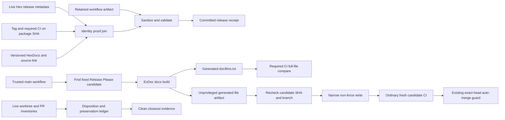

<user_constraints>
## User Constraints (from CONTEXT.md)

### Locked Decisions

- **D-01:** Treat tag `v1.6.0` and gated source SHA `9e80cb78d6374b1ed4074d5fef6b613fee879dca` as one immutable identity. Verify the Hex package metadata and published version, versioned HexDocs availability, source-reference destination, and Git tag resolution against that identity; a matching version string alone is insufficient.
- **D-02:** Verify the live HexDocs source reference through to the GitHub tag and commit. The release workflow's rendered-link string check is useful but does not by itself prove that the live destination resolves to the intended source.
- **D-03:** Commit a sanitized, machine-readable 1.6.0 receipt derived from the successful GitHub workflow artifact. It must identify the release run/attempt, package version, tag, gated source SHA, required CI run, Hex package, versioned docs, and source reference. Retain the hosted artifact as provenance; never include secret values.
- **D-04:** Bind required-CI evidence to the release source commit that produced `v1.6.0`. Record later protected-main commits separately so post-release maintenance is not mistaken for the package's source. Use current GitHub run and tag data, not stale local planning snapshots.

### Generated documentation index and hands-off releases

- **D-05:** Keep `doc/llms.txt` as a tracked ExDoc-generated artifact. Refresh it for the current 1.6.0 main source and add a required build-then-compare check after `mix docs --warnings-as-errors`; the check must cover both the version title and generated navigation/module rows.
- **D-06:** Keep Release Please version bumps fully automated. A trusted-main automation path must refresh only `doc/llms.txt` on the fixed Release Please candidate before exact-head auto-merge can succeed, then allow ordinary CI to rerun on the new head. The docs build receives no write token; the narrowly scoped write step rechecks the candidate SHA, uses a non-force update, and fails closed on races or errors. A stale or failed candidate never bypasses the required drift check or auto-merge gate.
- **D-07:** Do not rely on Release Please `extra-files` alone for this artifact: it can update a version marker but cannot regenerate ExDoc's dynamic module/navigation rows, and ExDoc removes inline updater annotations when rebuilding. Keep normal PRs subject to the same drift check; their failure message should say how to regenerate and commit the index.

### Repository and PR closeout

- **D-08:** Refresh the complete worktree and open-PR inventories during closeout. Record each PR's release-blocking, release-relevant, or separate-follow-up disposition. The previously observed snapshot had five worktrees, extensive dirty root changes, fourteen open PRs, and Release Please PR #302 for 1.6.1; treat those counts and identities as prompts to recheck, not current proof.
- **D-09:** Preserve inherited and user work until its disposition is explicit and durable. Do not use reset, clean, force-push, or unrelated PR merges to manufacture a clean status. Satisfy the all-worktrees-clean criterion only after preserving each change set; if a change cannot be safely dispositioned, report the remaining blocker rather than claim success.
- **D-10:** Apply the existing guarded exact-head Release Please auto-merge policy only to eligible Release Please candidates with successful required CI on their current head. Record other PRs as follow-up when they are unrelated; do not merge them merely to reduce the queue.

### the agent's Discretion

- Choose the receipt's stable project path and exact schema while retaining the required source, tag, package, documentation, CI, run, and attempt identities.
- Choose the helper/workflow boundaries for index refresh, bounded race recovery, and actionable diagnostics, while keeping the build unprivileged and the write permission narrowly scoped.
- Choose deterministic tests for generated-index equality, version/module drift, candidate refresh, stale-head races, and failure behavior. Use the existing ExDoc and GitHub Actions seams rather than adding a new publishing platform.
- Choose the closeout ledger format and preservation mechanics after inspecting each live worktree and PR. Do not assume the old 60-path/14-PR snapshot is complete.
- Keep the operator experience centered on a clear CI result and linked receipt. This is release engineering and documentation work; no product UI, admin UI, or brandbook changes apply.

### Deferred Ideas

- New publishers, a broad CI/CD redesign, a multi-repository release platform, or a custom ExDoc/Release Please plugin.
- Merging unrelated Dependabot, evidence, or product PRs solely to empty the queue; each receives an explicit follow-up disposition instead.
- Phase 248's separate hosted manual-dry-run and failure/cancellation-artifact verification maintenance; Phase 249's published success proof does not close those historical gaps.
- Auth/admin UI, brandbook, product API, or unrelated feature work; this phase has no UI/UX design surface.

### Reviewed Todos (not folded)

- Other lexical matches from `todo.match-phase 249` were not directly about publishing/proving 1.6.0 and remain pending; do not auto-acknowledge them.
</user_constraints>

<phase_requirements>
## Phase Requirements

| ID | Description | Research Support |
|----|-------------|------------------|
| REL-01 | The exact requirement is: `Hex contains package version 1.6.0 built from the gated source, and live checks prove the versioned HexDocs and source reference resolve to the same release.` [VERIFIED: .planning/REQUIREMENTS.md:32] | Official Hex docs establish the publishing-to-docs relationship; use read-only live package/release metadata, tag resolution, versioned docs, and final source-link destination checks as separate evidence joins. |
| REL-02 | The exact requirement is: `The final protected-main release commit has green required CI, the release receipt is committed and points to that exact source, every local worktree is clean, and every open PR has a recorded disposition.` [VERIFIED: .planning/REQUIREMENTS.md:33] | Verify required CI on both the package source and final protected-main commit as distinct identities, commit the artifact-derived receipt, and preserve then disposition every worktree and PR before asserting clean closeout. Clarify the requirement's “that exact source” join in the plan and evidence schema; see Open Questions. |
</phase_requirements>

# Phase 249: Publish and Prove Sigra 1.6.0 - Research

**Researched:** 2026-10-09
**Domain:** Elixir package release proof, generated ExDoc drift automation, GitHub Actions security, repository closeout
**Confidence:** MEDIUM

## Summary

Plan Phase 249 as a source-identity proof and repository closeout, not a new publish. The discussion context records the release as already published and fixes the tag/source pair; it also says to re-read live GitHub and Hex state because the shared checkout is old and dirty. [VERIFIED: .planning/phases/249-publish-and-prove-sigra-1-6-0/249-CONTEXT.md:9-21] Make the durable receipt a sanitized derivative of the retained successful workflow artifact. Keep release-source CI, later protected-main CI, and the commit that contains the receipt as separately named identities. [VERIFIED: .planning/phases/249-publish-and-prove-sigra-1-6-0/249-CONTEXT.md:20-21] A version string or green aggregate alone cannot join these records; the locked decision requires tag/SHA, live docs destination, and required-CI identity checks. [VERIFIED: .planning/phases/249-publish-and-prove-sigra-1-6-0/249-CONTEXT.md:18-21]

For the documentation index, regenerate `doc/llms.txt` from ExDoc, track the full generated output, and have required CI build docs with warnings as errors before comparing the generated file byte-for-byte. [VERIFIED: .planning/phases/249-publish-and-prove-sigra-1-6-0/249-CONTEXT.md:24-26] The trusted-main candidate-refresh path must remain independent from ordinary PR drift detection: build without write credentials, pass only the generated index as data, revalidate the fixed candidate head before a narrowly scoped non-force update, and let the resulting ordinary candidate CI feed the existing exact-head auto-merge guard. [VERIFIED: .planning/phases/249-publish-and-prove-sigra-1-6-0/249-CONTEXT.md:25-26] GitHub documents that `GITHUB_TOKEN`-authored pushes do not start normal push workflows, so preserve the already selected event-capable credential path. [CITED: [GitHub GITHUB_TOKEN behavior](https://docs.github.com/en/actions/concepts/security/github_token)]

Closeout is an inventory and preservation operation. Refresh all local worktree and open-PR data, record a durable disposition for each item, preserve each change set before cleanup, and leave unrelated PRs as follow-up. [VERIFIED: .planning/phases/249-publish-and-prove-sigra-1-6-0/249-CONTEXT.md:28-38] The old Phase 248 13/18 report and its manual dry-run/failure/cancellation evidence gaps remain separate maintenance; they do not rewrite Phase 249's success criteria. [VERIFIED: .planning/phases/249-publish-and-prove-sigra-1-6-0/249-CONTEXT.md:118-127] The planning preflight also reported unresolved REL edge, adjacency, empty-input, and ordering probes: keep these flagged assumptions explicit in PLAN coverage and do not silently drop them. [CITED: orchestrator-provided Phase 249 preflight summary]

**Primary recommendation:** Reuse existing receipt, post-publish verifier, ExDoc build, required-CI, and exact-head merge seams; add only the live proof joins, the tracked index drift/refresh path, a disposition ledger, and deterministic failure/race tests required by the locked scope.

## Architectural Responsibility Map

| Capability | Primary Tier | Secondary Tier | Rationale |
|------------|-------------|----------------|-----------|
| Published package, docs, tag, and source identity proof | CI / release automation | Hex and GitHub APIs | Trusted scripts collect read-only remote evidence and join package version, tag SHA, required CI, docs, and source destination. [VERIFIED: .planning/phases/249-publish-and-prove-sigra-1-6-0/249-CONTEXT.md:18-21] |
| Sanitized release receipt | CI / release automation | Repository docs/evidence | A validated committed record derives from a retained hosted artifact and carries the source/run identities without secrets. [VERIFIED: .planning/phases/249-publish-and-prove-sigra-1-6-0/249-CONTEXT.md:20] |
| ExDoc `llms.txt` generation and drift gate | Build / CI | Release candidate automation | ExDoc owns generated content; CI compares the generated output; trusted-main automation repairs only the fixed Release Please candidate. [VERIFIED: .planning/phases/249-publish-and-prove-sigra-1-6-0/249-CONTEXT.md:24-26] |
| Release candidate refresh and exact-head merge eligibility | GitHub Actions | Git repository | Trusted workflow code identifies and rechecks the candidate, scopes write access, then relies on ordinary CI and existing exact-head merge criteria. [VERIFIED: .planning/phases/249-publish-and-prove-sigra-1-6-0/249-CONTEXT.md:25, .planning/phases/248-exact-source-release-gate/248-CONTEXT.md:18-20] |
| Worktree/PR closeout | Repository operations | GitHub API | Maintainers inventory and disposition local changes and remote PRs; no application database or UI participates. [VERIFIED: .planning/phases/249-publish-and-prove-sigra-1-6-0/249-CONTEXT.md:9, 28-38] |

## Standard Stack

### Core

| Library / tool | Version | Purpose | Why Standard |
|---------|---------|---------|--------------|
| Existing Mix project and pinned ExDoc dependency | Use the version pinned by the clean, current project source; ExDoc v0.40.4 docs were consulted; no dependency update is in scope. | Build docs and regenerate the tracked ExDoc index. | ExDoc documents `mix docs` as its static documentation build; `--warnings-as-errors` makes documentation warnings a failing build. [CITED: [ExDoc `mix docs`](https://hexdocs.pm/ex_doc/Mix.Tasks.Docs.html)] |
| GitHub Actions, existing Release Please and exact-head merge workflows | Existing workflow/action pins from the trusted project source; do not introduce a publisher or release framework. | Candidate refresh, ordinary required CI, artifact retention, and exact-head eligibility. | These are the locked project seams; GitHub's event and secure-use docs define the token and trust boundaries. [CITED: [Release Please Action](https://github.com/googleapis/release-please-action), [GitHub Actions events](https://docs.github.com/en/actions/reference/workflows-and-actions/events-that-trigger-workflows)] |
| Hex package/release metadata and HexDocs | Published 1.6.0 target; no install or publish operation. | Read-only proof of package release, versioned docs, and source links. | Hex says docs are published automatically when a package is published; the phase still requires live resolution of the actual source destination. [CITED: [Hex publish documentation](https://hex.pm/docs/publish)] |

### Supporting

| Tool | Purpose | When to Use |
|---------|---------|-------------|
| `gh` | Read run/artifact/PR/worktree-related GitHub state and produce linked evidence. | Use read-only queries for the required source CI and current PR inventory; obey the repository's CI watcher and rate-limit rules. |
| Git, `curl`, `jq` | Resolve tag/object identity and retrieve/parse public API or HTTP metadata. | Use in deterministic read-only evidence collectors and fixture-driven local tests; do not substitute local stale refs for live values. |
| Existing ExUnit and shell contract-test seams plus `actionlint` | Prove workflow structure, generated-index comparison, receipt validation, event/permission boundaries, and race failure behavior. | Add focused tests with no new dependency; run the repo's current required CI command from a clean trusted source checkout. |

No external package installation is required by this phase; the Package Legitimacy Audit is not applicable. Do not install a docs or workflow package as part of research or planning.

## Architecture Patterns

### System Architecture Diagram



### Recommended Project Structure

Reuse the existing release workflow/scripts and CI test locations cited in the phase context. Add only phase-owned artifacts for the committed receipt, inventory/disposition ledger, index drift helper and tests, and any workflow-contract cases needed to cover the new trigger and permission boundaries. Do not create a new release platform, custom ExDoc formatter, Release Please plugin, or UI. [VERIFIED: .planning/phases/249-publish-and-prove-sigra-1-6-0/249-CONTEXT.md:63-72, Deferred Ideas]

### Pattern 1: Build first, compare all generated output

**What:** Run the existing documentation build with warnings as errors, then compare the complete newly generated `doc/llms.txt` to the tracked file. Emit actionable output naming the generation command and path. Include tests with a changed version title, a changed generated navigation/module row, and unchanged matching output.

**When to use:** Required CI on all relevant PRs, including normal contributor PRs and Release Please candidates.

**Evidence:** ExDoc's current Mix task documents the default output directory and `--warnings-as-errors`; its changelog documents default `llms.txt` generation beginning in v0.40.0. [CITED: [ExDoc Mix task](https://hexdocs.pm/ex_doc/Mix.Tasks.Docs.html), [ExDoc changelog](https://hexdocs.pm/ex_doc/changelog.html)]

### Pattern 2: Privilege-separated candidate refresh

**What:** Trusted default-branch workflow logic discovers the current, uniquely eligible Release Please PR and snapshots its full head SHA. A build job without a write token checks out that candidate and generates docs. Transfer only `doc/llms.txt` plus validated identity metadata. A separate write step/job confirms the PR is still eligible and the full head SHA is unchanged, confirms the output contains only the permitted generated file, then makes a normal non-force update using the already approved event-capable credential. If the candidate advances, disappears, or the update races, fail closed and retry only within a bounded policy. After a successful update, require an ordinary CI run on the new head and let the existing exact-head merger decide eligibility.

**When to use:** To keep Release Please fully automated while maintaining the same required generated-file drift check as human-authored PRs.

**Security boundary:** GitHub grants `workflow_run` access to secrets/write tokens but warns that untrusted code and artifacts can cross that boundary. GitHub also suppresses follow-on workflows for ordinary `GITHUB_TOKEN` pushes. Keep the docs build unprivileged, the privileged workflow code on trusted main, artifact handling data-only, token exposure confined to the write operation, and permissions at the smallest job/step scope. [CITED: [GitHub Actions events](https://docs.github.com/en/actions/reference/workflows-and-actions/events-that-trigger-workflows), [GitHub GITHUB_TOKEN behavior](https://docs.github.com/en/actions/concepts/security/github_token), [GitHub secure use](https://docs.github.com/en/actions/reference/security/secure-use)]

### Pattern 3: Join release proof by immutable object identity

**What:** Capture current GitHub run and attempt data, retrieve the artifact from that exact trusted release run/attempt, validate its run/workflow/source identities and schema, then join it to Hex release metadata, the full `v1.6.0` tag object/commit, successful required CI on the package source SHA, the version-specific HexDocs page, and the rendered source reference followed through to the GitHub tag and commit. Store URL, observed identity, result, run ID/attempt and collection timestamp in a sanitized committed receipt. Treat downloaded artifacts as untrusted data, never executable input. Keep protected-main closeout CI identity separate from the package SHA.

**When to use:** REL-01 source/package proof and REL-02 closeout evidence.

**Evidence:** Hex states package publication automatically publishes documentation; that establishes a relationship between operations, not proof that a particular live link reaches the gated commit. The context's D-01–D-04 therefore correctly require live identity checks and retained workflow provenance. [CITED: [Hex publish documentation](https://hex.pm/docs/publish)]

### Pattern 4: Inventory before cleanup

**What:** Snapshot all worktrees, branch/base/HEAD identities, dirty tracked and untracked paths, and every currently open PR. Assign each PR one of the locked dispositions. Assign each change set a durable preservation location/owner and an explicit action before any cleanup. Then verify every worktree is clean and every open PR is represented in the ledger. A change that cannot be safely preserved/dispositioned remains an explicit blocker.

**When to use:** At closeout only, after refreshing live inventories. Treat historical counts as prompts, not acceptance evidence.

## Don't Hand-Roll

| Problem | Don't Build | Use Instead | Why |
|---------|-------------|-------------|-----|
| ExDoc navigation and module index | A hand-maintained list, a version-only substitution, or Release Please annotation as the sole generator | ExDoc build output and a whole-file equality gate | `llms.txt` is generated output; Release Please `extra-files` replaces annotated version values, while ExDoc documents default `llms.txt` generation. [CITED: [Release Please customization](https://github.com/googleapis/release-please/blob/main/docs/customizing.md), [ExDoc changelog](https://hexdocs.pm/ex_doc/changelog.html)] |
| Release identity | A version-only assertion or a second unrelated receipt model | Existing Phase 248 terminal receipt contract plus live package/tag/CI/docs/source identity joins | Tag/SHA, package, docs target, required CI, workflow run, and attempt must be auditable as one provenance chain. [VERIFIED: .planning/phases/249-publish-and-prove-sigra-1-6-0/249-CONTEXT.md:18-21, 88-90] |
| Event-trigger behavior | A `GITHUB_TOKEN` push followed by assumption that CI will run | The already selected event-capable token path and an observed normal CI run on the new candidate head | GitHub suppresses normal push-triggered workflows for `GITHUB_TOKEN` writes. [CITED: [GitHub GITHUB_TOKEN behavior](https://docs.github.com/en/actions/concepts/security/github_token)] |
| Release workflow security | A broad write-token job that also builds candidate code | Unprivileged docs build and narrowly privileged write after identity/path validation | `workflow_run` can expose secrets/write permissions; untrusted code/artifacts must not gain that authority. [CITED: [GitHub Actions events](https://docs.github.com/en/actions/reference/workflows-and-actions/events-that-trigger-workflows), [GitHub secure use](https://docs.github.com/en/actions/reference/security/secure-use)] |
| Worktree cleanliness | `git reset`, `git clean`, force push, or merging unrelated PRs | Preserve and disposition each change set, then prove clean status | Cleanup order and disallowed destructive actions are locked by context. [VERIFIED: .planning/phases/249-publish-and-prove-sigra-1-6-0/249-CONTEXT.md:28-31] |

**Key insight:** The evidence joins are the product here. A published semver and successful release artifact do not prove that live docs and the source link resolve to the same immutable commit, and green CI on later `main` is not CI for the package source. [VERIFIED: .planning/phases/249-publish-and-prove-sigra-1-6-0/249-CONTEXT.md:18-21]

## Common Pitfalls

### Pitfall 1: Treating version equality as source equality

**What goes wrong:** Hex, documentation, tag, and receipt all display `1.6.0`, but one points to a different tag or source commit.

**Why it happens:** Version strings are easy to compare and hide differing Git object identities.

**How to avoid:** Resolve the current tag to a full commit, compare it to the gated source SHA and exact required CI head, and follow the live HexDocs source link through to the resolved GitHub destination.

**Warning signs:** Evidence has no full SHA; a check only asserts rendered link text; the package receipt uses main's newer SHA.

### Pitfall 2: Refreshing only the docs version marker

**What goes wrong:** The title changes but `llms.txt` navigation or module rows remain stale.

**Why it happens:** ExDoc generates dynamic rows, while Release Please generic updaters replace annotated version strings.

**How to avoid:** Rebuild via ExDoc and compare the whole tracked file. Test at least title drift and generated-row drift.

**Warning signs:** Tests assert the version title only; generation annotations are treated as equivalent to a build.

### Pitfall 3: Privileged workflow loses CI event or executes candidate code with credentials

**What goes wrong:** A default-token push does not trigger fresh candidate CI, or candidate build code can read a token that can mutate the PR.

**Why it happens:** GitHub suppresses ordinary follow-on workflow runs from `GITHUB_TOKEN`; some completion triggers run trusted branch workflow code with write access while processing untrusted inputs/artifacts.

**How to avoid:** Keep build and write privilege separate; pin candidate SHA; validate that only the intended file is carried across; use the already approved event-capable credential for the narrow update; then require a fresh ordinary CI check and exact-head revalidation.

**Warning signs:** Same job has `mix docs` and write token; workflow assumes `push` CI without a hosted run; merge trusts a prior SHA.

### Pitfall 4: Racing a changing Release Please branch

**What goes wrong:** The workflow overwrites newer candidate content or attaches generated docs from one head to another.

**Why it happens:** Release Please can update its fixed branch while docs generation is running.

**How to avoid:** Record full head SHA at discovery; requery immediately before write; use normal non-force push with expected-base semantics; on mismatch, do not bypass drift or auto-merge gates. Bound retries and preserve a diagnostic with observed and expected SHAs.

**Warning signs:** Force push, checkout branch name without comparing SHA, silent success on push failure, or old CI run accepted for the newly changed head.

### Pitfall 5: Confusing final main with package source

**What goes wrong:** Receipt points at later post-release commits and falsely implies they were in the Hex tarball.

**Why it happens:** The receipt may be committed after the package release and CI results may exist for multiple related commits.

**How to avoid:** Give the package source, required CI run for that source, final protected-main closeout commit, its required CI, and receipt commit/source fields distinct names and assertions. Resolve the one ambiguous phrase in REL-02 explicitly in the plan before claiming complete.

**Warning signs:** One `sha` field is reused for all identities; current-main CI is offered as proof for the published package.

### Pitfall 6: Claiming clean closeout by deleting work

**What goes wrong:** Uncommitted or untracked inherited work disappears and the repository appears clean.

**Why it happens:** Clean status is treated as the objective rather than the postcondition after preservation.

**How to avoid:** Capture complete per-worktree inventories and PR list, preserve each change set at a durable location, record owner/disposition and only then clean the relevant checkout. Do not classify old snapshot counts as current.

**Warning signs:** Destructive Git command before inventory; a ledger covers only root checkout; PR list lacks a disposition row for one open PR.

## Code Examples

Verified documentation patterns from official sources:

### Documentation build and drift gate

```sh
mix docs --warnings-as-errors
```

After the build, compare the complete tracked index with the generated output using the helper/path convention found in the clean trusted source. The output-directory variable and receipt property names must be selected from the implementation rather than inferred here. ExDoc states that `--warnings-as-errors` exits nonzero if warnings occur and that command-line options override project configuration. [CITED: [ExDoc `mix docs`](https://hexdocs.pm/ex_doc/Mix.Tasks.Docs.html)]

### Release Please generic updater boundary

Release Please's supported generic updater uses annotations and replaces version values on an annotated line or within an annotated block. Use it only where version substitution is the requirement; it cannot replace the ExDoc generation-and-compare flow for a file whose navigation rows must be regenerated. [CITED: [Release Please arbitrary-file updates](https://github.com/googleapis/release-please/blob/main/docs/customizing.md#updating-arbitrary-files)]

### Receipt identity fields

Project context requires the receipt to identify the release run/attempt, package version, tag, gated source SHA, required CI run, Hex package, versioned docs, and source reference. Choose exact property names by reading and extending the existing receipt helper's schema; do not create a second identity model. Never copy credentials or token-bearing URLs into the receipt. [VERIFIED: .planning/phases/249-publish-and-prove-sigra-1-6-0/249-CONTEXT.md:20]

## Environment Availability

| Dependency | Required By | Available | Version | Fallback |
|------------|------------|-----------|---------|----------|
| Mix / Elixir / OTP | ExDoc docs build and project contract tests | ✓ | Mix 1.19.5; Elixir 1.19.5; OTP 28 (local shell) | Use the project's pinned toolchain in its CI runner; do not assert local shell is the release source. |
| GitHub CLI (`gh`) | Workflow/artifact/PR read-only evidence | ✓ | 2.101.0 | GitHub REST/GraphQL API via the existing authenticated workflow environment. |
| `actionlint` | Workflow syntax validation | ✓ | 1.7.12 | Treat missing tool as a setup requirement using the approved tool source. |
| `curl`, `jq`, Git | Public metadata/source resolution and identity join | ✓ | curl 8.7.1; jq 1.7.1; Git 2.41.0 | Existing GitHub and Hex APIs; no need to infer from cache. |
| Node.js | Existing repository workflow/contract tests where used | ✓ | 22.14.0 | Use the project version declared in trusted source if it differs. |
| GitHub/Hex live API access and repository credentials | Live proof and inventories | Not exercised in this research pass | — | Run the read-only collectors in authorized workflow context; preserve an explicit blocked result if unavailable. |

**Probe provenance:** Local versions above came from direct `command -v` and version probes during this session. They describe this research shell only; `git status --short --branch` showed modified and untracked paths, and phase context identifies the shared root as an older branch. [VERIFIED: direct local command probes and git status; .planning/phases/249-publish-and-prove-sigra-1-6-0/249-CONTEXT.md:11]

The shared checkout reports many modified and untracked files and is explicitly identified by phase context as stale for release code. It is only research input, not a suitable basis for live source identity or a clean-closeout claim. [VERIFIED: direct local `git status --short --branch`; .planning/phases/249-publish-and-prove-sigra-1-6-0/249-CONTEXT.md:11] No GitHub or Hex mutation was performed.

## Validation Architecture

The project has Nyquist validation enabled; config contains the verbatim value `"nyquist_validation": true`. [VERIFIED: .planning/config.json:21] Research file discovery did not locate phase-249 tests; [ASSUMED] the plan must add focused regression coverage for the new gate and automation. Current local validation must use a clean trusted source and its declared CI command; do not infer the full-suite command from this older dirty checkout. [VERIFIED: .planning/phases/249-publish-and-prove-sigra-1-6-0/249-CONTEXT.md:11]

The project's evidence-feasibility rule says to resolve the full baseline commit and required evidence sources before implementing work that depends on exact identities or an external authority. Start planning with a read-only readiness/preflight task that proves the retained artifact, package/tag evidence and necessary CI records are retrievable; if the preflight is blocked, retain the blocker and do not begin release-state mutation. [VERIFIED: .planning/METHODOLOGY.md:20-26]

### Test Framework

| Property | Value |
|----------|-------|
| Framework | [ASSUMED] Existing Elixir ExUnit, shell fixtures, and workflow contract tests; versions as pinned by current source |
| Config file | Existing `mix.exs` and workflow/test configuration; resolve exact paths and aliases from the clean trusted source before tasking |
| Quick run command | Focused new helper fixture test, focused new workflow contract test, and `actionlint` on changed workflow files |
| Full suite command | The exact CI command used by the trusted current `ci-gate`; inspect the source workflow/alias when planning instead of adopting the stale root checkout's command |

### Phase Requirements → Test Map

| Req ID | Behavior | Test Type | Automated Command | File Exists? |
|-------------|-----------|-----------|-------------------|-------------|
| REL-01 | Receipt joins live package, tag SHA, source CI, versioned docs and resolved source link | contract + read-only integration | New fixture-driven receipt/verifier tests; then run the authorized live read-only release proof | ❌ Wave 0 |
| REL-02 | Receipt is committed; final protected-main CI passes; every worktree is clean and every open PR is dispositioned | workflow/repository contract + live closeout | New inventory/ledger completeness contract; exact-head CI lookup and read-only `git worktree list`/status plus current PR list | ❌ Wave 0 |
| Cross-cutting | Full ExDoc-generated index is current on normal PRs | helper unit + required CI | Build docs, then run the full-file compare fixture and CI workflow contract | ❌ Wave 0 |
| Cross-cutting | Release Please candidate refresh fails closed on stale SHA, unexpected output path, push race, or failed CI | helper/workflow contract | Mock GH/Git command fixtures for identity and race branches; actionlint changed workflows | ❌ Wave 0 |

### Sampling Rate

- **Per task commit:** Focused changed helper tests, workflow contract tests, `actionlint`, and docs build/diff test for the index work.
- **Per wave merge:** The current trusted `ci-gate` command on the exact resulting commit.
- **Phase gate:** Live package/source proof, required CI evidence bound to exact SHAs, receipt validation/commit, refreshed complete worktree and PR ledgers, and a final clean-tree assertion.

### Wave 0 Gaps

- [ ] [ASSUMED] Receipt projection test: accepts the retained success artifact, rejects identity mismatch, and proves secret redaction.
- [ ] Live-source-verifier fixtures for tag-SHA mismatch, stale or missing CI run, docs unavailable, broken source link, and wrong source destination.
- [ ] ExDoc drift comparison test for version title, dynamic navigation/module row, and full equality.
- [ ] Candidate refresh workflow contract and race fixtures: new head, deleted candidate, non-Release Please PR, unexpected changed file, non-fast-forward update, and fresh CI requirement.
- [ ] Closeout ledger validation for one disposition per current PR and one preservation/location/action per dirty worktree change set.

## Security Domain

This phase changes release evidence and GitHub workflow authority; ASVS application controls such as end-user session management are largely outside scope. Apply the security domain to privileged workflow execution, external evidence, and secret handling.

### Applicable ASVS Categories

The category labels in the generic research template match ASVS 4.x. OWASP now lists ASVS 5.0.0 as its latest stable release, with reorganized chapters. Use the current 5.0.0 names below rather than carrying the old chapter numbers into plan evidence. [CITED: [OWASP ASVS stable release](https://github.com/OWASP/ASVS/releases), [OWASP ASVS v5.0.0 standard](https://github.com/OWASP/ASVS/blob/v5.0.0/5.0/docs_en/OWASP_Application_Security_Verification_Standard_5.0.0_en.xml)]

| ASVS 5.0.0 category | Applies | Standard Control |
|---------------|---------|-----------------|
| V2 Validation and Business Logic | yes | Validate workflow inputs and joined evidence at a trusted helper boundary; fail closed on mismatch, missing identity, or malformed records. |
| V5 File Handling | yes, generated artifact handling | Restrict transferred build output to the single approved generated file; validate the path and content before a write step consumes it. |
| V6 Authentication | yes, GitHub/Hex credential identity | Use the already selected scoped credentials only for authorized operations; do not expose or log credential values. |
| V7 Session Management | no | The phase does not modify application login/session handling. |
| V8 Authorization | yes | Scope workflow permissions to the job/step that needs mutation; restrict candidate and path. |
| V11 Cryptography | no custom crypto | Use GitHub/Hex credential mechanisms; do not design or implement signing/encryption primitives in this phase. |
| V13 Configuration | yes | Verify intended workflow environments and secret names from authoritative configuration; do not infer scope from a non-empty secret boolean. |

### Known Threat Patterns for GitHub Actions and release automation

| Pattern | STRIDE | Standard Mitigation |
|---------|--------|---------------------|
| A candidate PR/artifact is mistaken for trusted workflow code | Elevation of privilege / Spoofing | Run the build without write secrets, use trusted default-branch workflow code for the mutation, correlate source run and candidate identity, and never execute downloaded artifact content. |
| Docs build changes files outside the generated index | Tampering | Require the privileged write input to contain only the fixed `doc/llms.txt` path and re-check the diff before push. |
| Candidate branch advances after build | Tampering / Repudiation | Re-read full head immediately before writing, use non-force update, stop on non-fast-forward, and require CI for the resulting exact SHA. |
| Default token push suppresses required CI | Denial of service / Integrity | Use the locked event-capable credential for the narrow update and assert that normal CI actually ran on the resulting head. |
| Receipt contains credential or mismatched provenance | Information disclosure / Spoofing | Project only approved identity fields from validated artifact, reject extra secret-bearing values, schema-test redaction, and compare all identity joins before commit. |
| Worktree cleanup removes unowned inherited work | Tampering / Denial of service | Inventory and durably preserve changes before cleanup; stop with a blocker where ownership/disposition cannot be established. |

GitHub's secure-use documentation recommends least privilege and permission increases only at the job that needs them. Its `workflow_run` docs warn that the trigger has secrets/write tokens and that processing untrusted code or artifacts can create vulnerabilities. Its `GITHUB_TOKEN` documentation confirms ordinary workflow-generated pushes do not start another push workflow. [CITED: [GitHub secure use](https://docs.github.com/en/actions/reference/security/secure-use), [workflow_run event](https://docs.github.com/en/actions/reference/workflows-and-actions/events-that-trigger-workflows), [GITHUB_TOKEN event behavior](https://docs.github.com/en/actions/concepts/security/github_token)]

## State of the Art

| Older approach | Current approach | When changed | Impact |
|--------------|------------------|--------------|--------|
| Hand-maintained or version-only `llms.txt` | ExDoc generates `llms.txt` by default; build it and compare the full tracked artifact. | ExDoc v0.40.0, 2026-01-20 per its changelog. | Catch both version title drift and generated navigation/module drift. [CITED: [ExDoc changelog](https://hexdocs.pm/ex_doc/changelog.html)] |
| Release Please generic annotations as generator | Generic updater remains a version replacement mechanism; use a real ExDoc build for dynamic rows and a trusted candidate refresh to retain automation. | Current Release Please customization docs and locked Phase 249 decision. | Keep automatic bumps while requiring the same drift gate on ordinary PRs. [CITED: [Release Please customization](https://github.com/googleapis/release-please/blob/main/docs/customizing.md), [249-CONTEXT.md](.planning/phases/249-publish-and-prove-sigra-1-6-0/249-CONTEXT.md)] |
| Assume a workflow-created push runs CI | Use the phase-approved event-capable credential for the narrow push and assert ordinary CI ran on the resulting head. | Current GitHub Actions token behavior. | Prevent a missing CI run from appearing to satisfy exact-head merge policy. [CITED: [GITHUB_TOKEN event behavior](https://docs.github.com/en/actions/concepts/security/github_token)] |
| Legacy ASVS 4.x category labels | Use current ASVS 5.0.0 chapter names when mapping workflow threats. | OWASP ASVS v5.0.0 release, 2025-05-30. | Keeps the security map versioned and correctly labeled. [CITED: [OWASP ASVS v5.0.0 release](https://github.com/OWASP/ASVS/releases)] |

**Deprecated/outdated:** Treating a rendered source-link string as proof of its live destination is explicitly insufficient for this phase; resolving the link through to the tagged commit is required. [VERIFIED: .planning/phases/249-publish-and-prove-sigra-1-6-0/249-CONTEXT.md:18-20]

## Project Constraints (from AGENTS.md)

- For any admin UI work, use `guides/reference/admin-ui-principles.md` and `guides/reference/admin-design-contract.md`; preserve `sg-*` cascade-layer/BEM, Rail Accent brand assets, Light/Dark/System modes, and deterministic Playwright role selectors, stable hooks, LiveView readiness, and no sleeps. The exact directives include `"Preserve the `sg-*` cascade-layer/BEM design system."` and `"Support Light, Dark, and System modes."` This phase has no UI/admin UI work. [VERIFIED: AGENTS.md:3-10; .planning/phases/249-publish-and-prove-sigra-1-6-0/249-CONTEXT.md:38]
- Within authorized scope, prefer deterministic tests, browser automation, CI polling, and committed machine-readable evidence over human UAT. Agents may create/update scoped evidence branches and PRs, dispatch CI and inspect logs when the authorized delivery flow needs them. Retry transient failures once; diagnose and repair deterministic failures; never waive, auto-approve, or mark missing evidence as passed; do not expand into unrelated phases. [VERIFIED: AGENTS.md:12-17]
- At GSD stops, report the exact next command and distinguish implementation from verification. Before context reset, persist route, blockers and evidence references in handoff/state. Before forward routing after phase completion, check the next phase with `init.plan-phase <n>` or `init.execute-phase <n>` as applicable, keep `.planning/STATE.md` and `.planning/state.json` aligned, and distinguish stale verification maintenance. This research task does not set the next phase route. [VERIFIED: AGENTS.md:19-39]
- For GitHub API/CI use, allow at most one watcher per run; the required command is `"gh run watch <run-id> --repo szTheory/sigra --compact --interval 60 --exit-status"`; check `"gh api rate_limit"` before a long watch; stop polling at `"250 or fewer requests remaining"` or on HTTP 403/429 until reset/retry time; after completion fetch one structured summary and failed logs only for failures. [VERIFIED: AGENTS.md:41-47]
- Preserve inherited changes and avoid destructive reset, clean, or force-push. Any eventual external write must be explicitly required by the phase's authorized release workflow and supported by deterministic evidence. [VERIFIED: AGENTS.md:14-17; .planning/phases/249-publish-and-prove-sigra-1-6-0/249-CONTEXT.md:28-31]

## Assumptions Log

| # | Claim | Section | Risk if Wrong |
|---|-------|---------|---------------|
| A1 | [ASSUMED] A small fixture-driven shell helper plus workflow-contract tests are the best fit for the existing release proof seams. | Validation Architecture | May duplicate an existing test or contract helper; planner must inspect the clean trusted-source tests before adding files. |
| A2 | [ASSUMED] The trusted-main candidate refresh can isolate docs build and write into separate jobs while transferring only a validated generated file. | Architecture Patterns | Workflow artifact or permissions constraints may require a different boundary; retain the same no-token build and exact-SHA fail-closed requirements. |
| A3 | [ASSUMED] Local Mix/Elixir versions are relevant only for planning setup and do not prove compatibility of the gated source. | Environment Availability | A clean execution workspace may use another pinned toolchain; re-probe it before implementation. |
| A4 | [ASSUMED] No phase-249 test file currently exists in this checkout. | Validation Architecture | A clean trusted source may already contain relevant coverage; inspect before adding duplicative tests. |

## Open Questions

1. **What exact source must REL-02's committed receipt point to?**
   - What we know: REL-01 and D-01–D-04 bind the published artifact, its required CI, tag, and receipt to the gated package source SHA; D-04 says later protected-main commits are recorded separately. [VERIFIED: .planning/REQUIREMENTS.md:32; .planning/phases/249-publish-and-prove-sigra-1-6-0/249-CONTEXT.md:18-21]
   - What's unclear: REL-02 says “the final protected-main release commit has green required CI” and that the receipt “points to that exact source,” which can be read as requiring a main-closeout SHA or the published package SHA.
   - Recommendation: In the plan, model package source SHA, final protected-main SHA, receipt commit SHA, and each corresponding CI run as distinct named fields; state the join explicitly and keep all CI-green claims on exact heads. If acceptance truly requires a different relationship, preserve it as an explicit flagged assumption rather than silently changing the receipt identity.

2. **Do the unresolved spec-less edge probes change REL-01/REL-02 coverage?**
   - What we know: Phase preflight found REL-01 unclassified/unresolved and REL-02 adjacency, empty-input, and ordering probes unresolved. [CITED: orchestrator-provided Phase 249 preflight summary]
   - What's unclear: The generated probes did not settle whether these are required external edge-case behaviors or planner heuristics.
   - Recommendation: Keep the findings explicitly in plan coverage/assumption notes, map them to a concrete deterministic acceptance probe where meaningful, and do not silently omit them or elevate probe labels into user requirements.

3. **Which current CI entrypoint and exact current source workspace should run validation?**
   - What we know: project policy requires current trusted-source evidence; the shared root checkout is dirty/stale and cannot establish source truth. [VERIFIED: .planning/METHODOLOGY.md:20-26; .planning/phases/249-publish-and-prove-sigra-1-6-0/249-CONTEXT.md:11]
   - What's unclear: this research session did not refresh a separate clean current-main source workspace or derive its full-suite alias.
   - Recommendation: Before implementation, inspect the exact trusted current main source and its CI workflow/alias, and use its declared CI gate. Avoid using this dirty checkout as release evidence.

## Sources

### Primary (MEDIUM confidence; official docs opened and cross-checked)

- [Release Please customization documentation](https://github.com/googleapis/release-please/blob/main/docs/customizing.md) — generic `extra-files` updater and annotation behavior.
- [Release Please Action documentation](https://github.com/googleapis/release-please-action) — manifest setup, action token input, and release outputs.
- [ExDoc `mix docs` task](https://hexdocs.pm/ex_doc/Mix.Tasks.Docs.html) — generated docs, default output and warnings-as-errors behavior.
- [ExDoc changelog](https://hexdocs.pm/ex_doc/changelog.html) — `llms.txt` default generation introduced in v0.40.0 and current changelog.
- [GitHub Actions events](https://docs.github.com/en/actions/reference/workflows-and-actions/events-that-trigger-workflows) — `workflow_run` behavior and untrusted-code warning.
- [GitHub GITHUB_TOKEN behavior](https://docs.github.com/en/actions/concepts/security/github_token) — token-authored push event suppression and exceptions.
- [GitHub secure use](https://docs.github.com/en/actions/reference/security/secure-use) — least-privilege token permissions and secret handling.
- [Hex package publishing](https://hex.pm/docs/publish) — package metadata and automatic docs publication behavior.
- [OWASP ASVS v5.0.0 stable release and chapter specification](https://github.com/OWASP/ASVS/releases) — current stable chapter map and security verification version.
- [.planning/REQUIREMENTS.md:32-33] — quoted REL-01/REL-02 requirement text in `<phase_requirements>`.
- [.planning/phases/249-publish-and-prove-sigra-1-6-0/249-CONTEXT.md:18-38] — verbatim user constraints above, and locked source/proof/automation/closeout scope.
- [AGENTS.md] — project constraints transcribed above.

### Secondary (LOW confidence / non-authoritative)

- `prompts/elixir-oss-lib-ci-cd-best-practices-deep-research.md` and `prompts/elixir-opensource-libs-best-practices-deep-research.md` — reviewed as project-specific background; primary official docs govern current workflow behavior.
- [.planning/phases/248-exact-source-release-gate/248-VERIFICATION.md](.planning/phases/248-exact-source-release-gate/248-VERIFICATION.md) — the committed 13/18 report and hosted manual/failure/cancellation gaps are historical maintenance input, not a Phase 249 blocker. [VERIFIED: .planning/phases/249-publish-and-prove-sigra-1-6-0/249-CONTEXT.md:118-127]

Live Hex API and HexDocs URLs could not be read by the available web fetch tool in this pass. [VERIFIED: direct web fetch attempts returned inaccessible] This yields no observation about their current contents; the phase must perform its explicitly required live checks from the authorized evidence collector.

## Metadata

**Confidence breakdown:**
- Standard stack: MEDIUM — official ExDoc, Release Please, GitHub Actions and Hex docs support the named existing seams; current clean-source versions must be reread by planner/executor.
- Architecture: MEDIUM — locked phase context is detailed, and primary docs verify generator/token behavior; candidate workflow topology still needs workflow-contract validation.
- Pitfalls: MEDIUM — event, token, ExDoc and updater behavior are verified in official docs; actual current live release endpoints remain unobserved here.

**Research date:** 2026-10-09
**Valid until:** 2026-11-08 for stable design constraints; recheck live repository, PR, CI, package and documentation identities immediately before execution.
