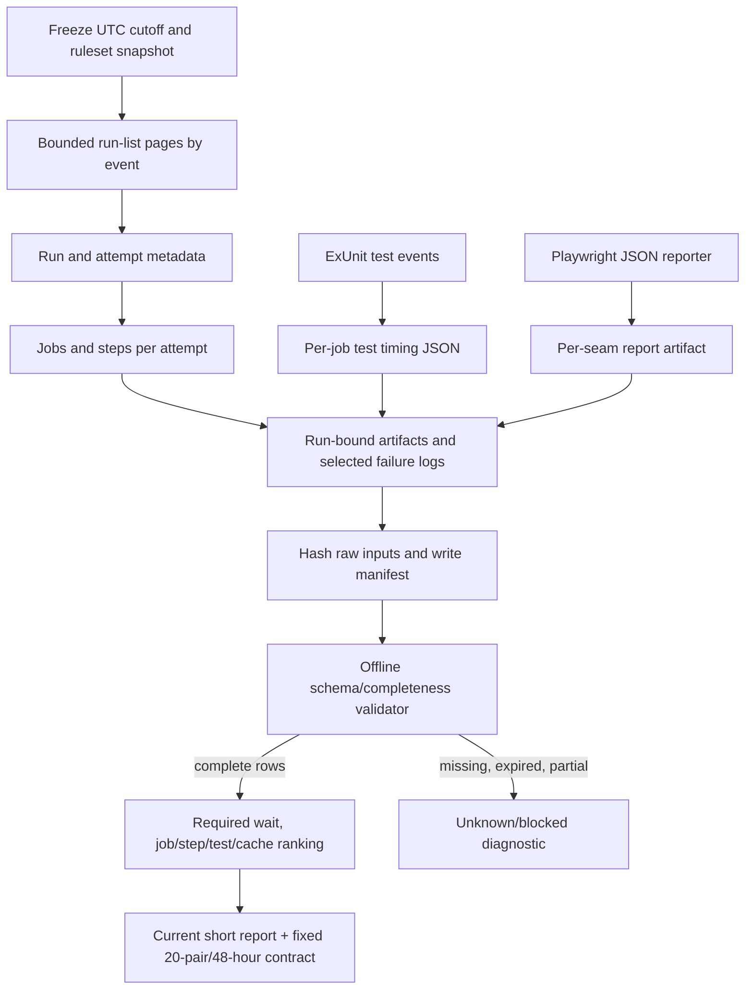

# Phase 252: Measure Current CI - Research

**Researched:** 2026-10-12  
**Domain:** GitHub Actions measurement, shell-based evidence collection, ExUnit timing, Playwright reports  
**Confidence:** HIGH for current repository structure and pinned APIs; MEDIUM for what hosted records will contain until the bounded collection runs

<user_constraints>
## User Constraints (from CONTEXT.md)

### Locked Decisions

### Current run populations and required result

- **D-01:** Keep pull-request, push-to-main and scheduled-nightly runs separate. Manual probes and release-branch pushes are separate populations. Preserve literal outcomes and all attempts before selecting any speed cohort.
- **D-02:** Separate full-workload and docs-only PRs using saved actual change/skip information. A changed mix of these PR types must not count as a speed improvement.
- **D-03:** Re-read and save effective required rules before collection. The discovery check confirmed ruleset `14941512` requires `Library tests`, `Example unit smoke (ExUnit + ConnTest)`, `Install smoke (fresh phx.new + sigra.install)`, `Example HTTP smoke (boot + curl critical routes)`, and `Example Playwright smoke (full lifecycle)`. A changed rule is a concrete measurement-contract diagnostic, not permission to silently choose a different endpoint.
- **D-04:** Required PR-result elapsed time is original run creation to completion of the last enforced required context for that revision/run family. Record first-attempt and eventual-after-rerun waits separately. Missing, cancelled or unexpectedly skipped required work cannot become a successful speed observation. Report internal `ci-gate` and whole-workflow completion as additional diagnostics.
- **D-05:** Report initial waiting, dependency/orchestration gaps and job execution separately where source timestamps support them. Run creation to first actual job start is initial waiting; it is not proof of pure runner queue duration. Unknown queue or timestamp data stay unknown.
- **D-06:** Runner time is summed actual job start-to-end durations across all executed jobs and attempts in the comparable run family. Keep cancellation and rerun costs. Distinguish this from parallel wall time and billed minutes; absent timestamps are not zero. A PR containing several source revisions must not silently become several independent observations of one revision.

### Lean collection and replay

- **D-07:** Extend `scripts/ci/ci-run-metrics.sh` and its existing hermetic seams instead of adding a service or package. Save raw run, per-attempt job and step records with offline replay commands. Parameterized `gh api` reads must explicitly select `--method GET`.
- **D-08:** Bind retained data to repository, run ID, attempt, event, branch, source SHA, workflow identity, job ID/name, required-check map, expected workload, literal outcome, timestamps, runtime/runner-image identity and cache outcome. Save source hashes and a manifest. Verify artifact origin from the producing run; a PR-authored artifact name or manifest cannot establish its own authority. Do not capture secrets or execute untrusted record text.
- **D-09:** Before acquisition, freeze a UTC cutoff. Take at most the latest **100 CI runs per event within the preceding 30 days**. Paginate to that fixed cap and disclose API total count and capped/exhausted status. This is a bounded snapshot, which may cover less than a month.
- **D-10:** Each acquisition pass stops at **600 HTTP requests or 60 minutes**, including pages, retries and artifact retrieval. Check the REST core budget before collection, stop at 250 or fewer remaining, and honor GitHub's reset/retry time on 403/429. One owner watches each run, with the repository's 60-second watcher interval. A transient read may be retried once within the budget. Retain interruptions and unavailable/expired inputs as durable diagnostics; do not extend the window to improve results.

### Native test timing and ranking

- **D-11:** Use a small opt-in, test-only ExUnit timing formatter and Playwright's built-in JSON reporter alongside existing human-readable reports. Add no dependency. Preserve the single `MIX_ENV=test mix ci` library owner, five isolated browser seams, `workers: 1`, `fullyParallel: false`, `retries: 0`, Sandbox ownership and useful test selection.
- **D-12:** Record completed test identity, result, duration and duration unit; Playwright records also identify project, seam and retry. Preserve skipped/excluded counts and report completeness. Output failure or partial data cannot turn into zero-cost entries or a green test result; report validation must preserve the original test exit status. Separate shared fixture/app boot/cache/setup and suite elapsed time from summed individual test time.
- **D-13:** Use identical timing instrumentation in both comparison conditions and account for its overhead. ExUnit `--slowest` is a local diagnostic, not this baseline: it enables trace behavior that changes scheduling and timeout conditions.
- **D-14:** Rank both critical-path contributor wait and summed runner cost. Break out setup, cache restore/download, compilation, database/app startup and test execution when measured. Archived timings and configured timeouts are leads, never current runtime measurements. Do not restore the obsolete two-shard library arrangement merely to measure it.

### Fixed later comparison

- **D-15:** Fix **20 matched pre/post pairs**, totaling 40 primary invocation families, before optimization. Freeze the exact baseline code/workflow identity after Phase 252 instrumentation and record the later candidate identity as the treatment. Match full PR workload, runner class and cache conditions; freeze cache-stratum allocation from the measured baseline before optimization. Record application/workload and workflow revisions separately rather than claiming an identical full repository SHA across a workflow change.
- **D-16:** Run the two code revisions within one predeclared **48-hour comparison window once both are available**. Record runner-image drift and incompatible conditions instead of pooling them silently. The planner can choose scoped, safe, non-publishing PR/evidence seams; manual-only dispatch timing does not replace actual PR wait.
- **D-17:** Do not replace failed, cancelled or non-comparable pairs to improve the numbers. One independently diagnosed infrastructure-only retry may stay inside its original family with every outcome/time/cost retained; test retries remain zero. Incomplete comparable successful pairs yield an insufficient-data result, not a pass.
- **D-18:** Median uses the middle value, averaging the two middle values for even samples. Empirical p95 uses nearest rank `ceil(0.95 * n)`. State that 20 pairs give a fragile tail estimate, not a population guarantee. Retain per-pair measurements, all outcome frequencies and family runner costs. Compare successful equivalent-workload timings while separately disclosing failures, cancellations and reruns. Compare total runner time over the same workload/count/strata and report its distribution. Target misses and unproved non-increase remain miss/unknown results; no favorable-window extension.

### Current failures and contributor output

- **D-19:** Choose at most **three current recurring failure signatures** after reading retained logs/reports. Begin bounded diagnostics with at most four newest failed families per event, twelve total. Separate test/application failure, infrastructure failure, superseded cancellation, expected skip, unexpected skip and missing job. A red run or a historical todo alone does not establish a flake.
- **D-20:** If adequate diagnostics identify no current flake, state that and define repeated isolation/readiness checks for Phase 253. Missing or expired diagnostics mean unknown, not no flake. The historical admin-eval WebKit registration recurrence is a lead already owned by Phase 253; it is not a proven current defect.
- **D-21:** Produce a short ranked report with source links, commands for offline replay/local timing and concrete limitations. Keep contributor instructions focused on reproducing results and failures. No reporting dashboard or product UI redesign.

### the agent's Discretion

Choose internal schema/helper/file organization, the narrow test-only formatter implementation, exact deterministic completeness checks, safe evidence storage and scoped comparison mechanics. Use official docs and current source to resolve these details without reopening broad option menus. The above population, endpoint, budget, sample, percentile, dependency and truth rules are locked. If a required source is unavailable, retain a concrete diagnostic and proceed with independent work; do not claim missing measurements passed.

### Deferred Ideas (OUT OF SCOPE)

- Current flaky-test fixes and required-gate fault injection: Phase 253.
- Job splitting, cache optimization, redundant-check removal or changed scheduling: Phase 254 only when current measurements support the choice and useful coverage remains proved.
- Final local reproduction guidance and complete before/after report: Phase 255.
- Product UI, public API/auth changes, reporting services, broad upgrades, paid runners, package release and historical release-proof recovery: outside this milestone.
- Missing 1.6 upgrade guidance remains its separate todo.

### Reviewed Todos (not folded)

- Orphaned timing machinery: inspect current measurements; preserve its existing ownership and historical disposition.
- Admin-eval WebKit recurrence: already linked to Phase 253; confirm against current diagnostics.
- Skip-manifest aggregator discrepancy: measurement must describe actual skips; repairing its guard is not added to Phase 252.
- Other keyword-only todo matches do not belong to current CI measurement and remain unchanged.
</user_constraints>

<phase_requirements>
## Phase Requirements

| ID | Description | Research Support |
|----|-------------|------------------|
| CIMEAS-01 | Contributors can see the current CI baseline for pull requests, main pushes, and nightly runs, with waiting time, execution time, run conclusions, and reruns recorded separately. | Use the Actions run/attempt/job/step records and the five saved required contexts to compute the required-result endpoint per D-01–D-06; keep raw inputs and calculation replay beside the summary. [VERIFIED: `.planning/REQUIREMENTS.md:12`] |
| CIMEAS-02 | Maintainers can identify the largest runtime costs from saved job/step/test measurements, including setup and cache work, and use a ranked list to select improvements. | Add an opt-in ExUnit event formatter and Playwright JSON output; keep cache-hit outputs and setup/test stages distinct; rank critical-path wait separately from summed runner cost. [VERIFIED: `.planning/REQUIREMENTS.md:13`] |
</phase_requirements>

## Project Constraints (from AGENTS.md)

- Write reports and contributor-facing explanations in plain English; name concrete missing data and what would resolve it. [VERIFIED: `AGENTS.md:3-8`]
- For authorized work, prefer deterministic checks and machine-readable evidence; do not turn missing evidence into a pass or expand into later-phase fixes. [VERIFIED: `AGENTS.md:19-24`]
- Preserve existing database/browser isolation, Playwright's zero-retry setting and deterministic readiness. Keep the five required-check names fixed. [VERIFIED: `AGENTS.md:17`; `.planning/phases/252-measure-current-ci/252-CONTEXT.md:22,36-37`]
- If any admin UI becomes part of a future implementation, follow both admin UI guides, preserve `sg-*` layers/BEM and Rail Accent assets, and support Light, Dark and System themes. This phase has no UI work. [VERIFIED: `AGENTS.md:10-17`]
- Keep GitHub API collection within D-09/D-10; use one watcher per run at 60-second intervals, inspect the core budget first, and stop on rate-limit responses until reset/retry time. [VERIFIED: `AGENTS.md:54-60`; `.planning/phases/252-measure-current-ci/252-CONTEXT.md:31-32`]
- Preserve dirty planning files before replacing them; this phase adds only the new research artifact and must not refresh dirty state or handoff files. [VERIFIED: `AGENTS.md:26-30`]
- Before reporting the next GSD command after a completed phase, inspect the next phase's readiness/context and keep implementation completion distinct from verification completion. [VERIFIED: `AGENTS.md:32-52`]

## Summary

Build Phase 252 around the existing shell collector and its PATH-shadowed hermetic test seam. Keep the collector responsible for bounded acquisition, immutable raw snapshots, validation and offline calculations; keep test instrumentation in the existing ExUnit and Playwright processes; let a small report/replay step join these records using GitHub's run/job identities. No new package or service is needed. [VERIFIED: `.planning/phases/252-measure-current-ci/252-CONTEXT.md:27-39`; `.planning/phases/252-measure-current-ci/252-CONTEXT.md:105-125`; `scripts/ci/ci-run-metrics.test.sh:1-6`]

The current collector measures only simplified wall/job-span summaries and does not identify all attempts, required contexts, steps, test rows, cache strata or p95. Existing discussion files are input scouting only: the discussion record explicitly says `"complete_phase_baseline": false`, `"failed_logs_collected": false`, `"pure_queue_duration_proved": false`, `"cache_strata_proved": false`, and `"test_costs_proved": false`. Use none of those source files as accepted baseline evidence. [VERIFIED: `scripts/ci/ci-run-metrics.sh:11-36`; `.planning/phases/252-measure-current-ci/252-DISCUSSION-RECORD.json:177-182`; `.planning/phases/252-measure-current-ci/discussion-sources/manifest.json:1-6,79-83`]

**Primary recommendation:** Extend `ci-run-metrics.sh` to acquire and replay attempt-scoped run/job/step/artifact data under the fixed budgets; add opt-in ExUnit test events and Playwright's built-in JSON output to existing job artifacts; validate source identities, workload, completeness and status before producing a short current baseline and fixed later comparison contract. [VERIFIED: `.planning/phases/252-measure-current-ci/252-CONTEXT.md:20-52`]

## Architectural Responsibility Map

| Capability | Primary Tier | Secondary Tier | Rationale |
|------------|-------------|----------------|-----------|
| Retrieve run/attempt/job/step/artifact records | CI measurement script | GitHub Actions REST API | The script owns pagination, request caps and local durable raw inputs; the API is the source for hosted run metadata. [CITED: https://docs.github.com/en/rest/actions/workflow-runs; https://docs.github.com/en/rest/actions/workflow-jobs] |
| Test-level durations | Test process (ExUnit / Playwright) | Artifact and report collector | Durations belong inside the runner where test identity and completed-test status are known; do not estimate them from job duration. [CITED: https://github.com/elixir-lang/elixir/blob/v1.19.5/lib/ex_unit/lib/ex_unit/formatter.ex; https://playwright.dev/docs/api/class-testresult] |
| Required-result wait and runner cost | Offline analysis/report | GitHub run and job records | Compute from saved timestamps and literal outcomes; wall wait and sum of job durations answer different questions. [VERIFIED: `.planning/phases/252-measure-current-ci/252-CONTEXT.md:23-25`] |
| Workload and expected-skip classification | Offline analysis/report | CI diff/skip outputs | Save the actual docs-only classification and executed/skipped job/step map; do not infer workload from PR title or an aggregate green gate. [VERIFIED: `.github/workflows/ci.yml:119-169`; `.planning/phases/252-measure-current-ci/252-CONTEXT.md:20-24`] |
| Artifact provenance | Collector | GitHub artifact/run metadata | Match artifact ID and `workflow_run.id/head_sha` to the producing run before reading data; artifact name or embedded JSON cannot authenticate itself. [CITED: https://docs.github.com/en/rest/actions/artifacts] |

## Standard Stack

### Core

| Library/tool | Version | Purpose | Why standard |
|---|---:|---|---|
| Bash + `jq` + `gh` | Present on this research machine; version was not measured | Bounded collector and hermetic fixtures | The current collector already calls `gh` through `PATH` and uses `jq`; the self-test shadows `gh`, making replay independent of the network. [VERIFIED: local `command -v` probe; `scripts/ci/ci-run-metrics.sh:44-47,93-124`; `scripts/ci/ci-run-metrics.test.sh:4-6`] |
| Erlang/OTP | `28.5` | CI/runtime identity for the library suite | Exact repo pin: [VERIFIED: `.tool-versions:1`] quote: `erlang 28.5`. |
| Elixir | `1.19.5-otp-28` | ExUnit formatter API and `mix ci` | Exact repo pin: [VERIFIED: `.tool-versions:2`] quote: `elixir 1.19.5-otp-28`. Use formatter timing from this pinned runtime, not older Phase 230 notes. |
| Playwright Test | `1.59.1` | Native JSON test report | The lockfile resolves `@playwright/test`, `playwright`, and `playwright-core` to `1.59.1`. [VERIFIED: `test/example/priv/playwright/package-lock.json:121-128,566-573,585-590`] quotes: `"version": "1.59.1"` and `"playwright": "1.59.1"`. |
| Node.js | `20` in Playwright boot action | Playwright runtime | Existing composite action selects Node `20`. [VERIFIED: `.github/actions/example-playwright-boot/action.yml:68-72`] quote: `node-version: "20"`. |

### Supporting

| Tool/API | Purpose | When to use |
|---|---|---|
| GitHub Actions REST API | Paginated workflow run list; exact run attempt; per-attempt jobs and steps; artifacts and redirects | Collection only, with explicit `GET`, fixed cutoff/cap and the authorized request/rate limits. GitHub documents run identity including `head_sha`, event, conclusion, attempt and timestamps, and job records including step timestamps and runner labels. [CITED: https://docs.github.com/en/rest/actions/workflow-runs; https://docs.github.com/en/rest/actions/workflow-jobs] |
| ExUnit formatter events | Capture completed test identity/state/time and suite timing | Only when the opt-in timing flag/path is enabled; retain the default CLI formatter and normal scheduling. ExUnit v1.19.5 defines `{:test_finished, test}`, `test.time` in microseconds, and suite `run/async/load` in microseconds. [CITED: https://github.com/elixir-lang/elixir/blob/v1.19.5/lib/ex_unit/lib/ex_unit/formatter.ex; https://github.com/elixir-lang/elixir/blob/v1.19.5/lib/ex_unit/lib/ex_unit.ex] |
| Playwright built-in JSON reporter | Save per-test structured output alongside existing human-readable reporters | Add to existing config/commands and artifact paths; do not replace the `list` and `html` reporters. JSON reporter can write to a file; `TestResult` has duration in milliseconds, status, retry and start time. [CITED: https://playwright.dev/docs/test-reporters; https://playwright.dev/docs/api/class-testresult] |

### Alternatives Considered

| Instead of | Use | Tradeoff |
|---|---|---|
| New analytics service or package | Existing shell collector, ExUnit formatter protocol and Playwright JSON reporter | The task needs a bounded snapshot with offline replay, not a continuously hosted data product. This follows the locked no-service/no-dependency decision. [VERIFIED: `.planning/phases/252-measure-current-ci/252-CONTEXT.md:29-38`] |
| ExUnit `--slowest` / trace mode | Opt-in formatter receiving the normal suite events | ExUnit documents that `--slowest` turns on trace mode; trace sets `max_cases` to one and changes timeout behavior, so its timing would perturb the measurement conditions. [CITED: https://github.com/elixir-lang/elixir/blob/v1.19.5/lib/ex_unit/lib/ex_unit.ex] |
| `updated_at - created_at` as required PR wait | Original creation through last enforced required context completion, plus separate first-attempt and eventual wait | Whole workflow close can include optional trailing work; aggregate job end does not prove the required endpoint. [VERIFIED: `.planning/phases/252-measure-current-ci/252-CONTEXT.md:22-25`] |

**Installation:** None. Add no runtime or development dependency. [VERIFIED: `.planning/phases/252-measure-current-ci/252-CONTEXT.md:29,36`]

## Architecture Patterns

### Data flow

The REST run record provides `id`, `head_sha`, `event`, `status`, `conclusion`, `workflow_id`, `run_attempt`, `created_at`, `updated_at`, and `run_started_at`; job records include `started_at`, `completed_at`, `steps`, and runner labels. Use those actual fields and preserve nulls. Job `started_at - created_at` is an initial-wait measure only; it does not isolate GitHub's internal queue from DAG dependencies or dispatch delay. [CITED: https://docs.github.com/en/rest/actions/workflow-runs; https://docs.github.com/en/rest/actions/workflow-jobs; VERIFIED: `.planning/phases/252-measure-current-ci/252-CONTEXT.md:23-25`]

### Recommended Project Structure and Analog Pointers

| Responsibility | Candidate location/pattern | Existing analog |
|---|---|---|
| Collection, raw validation, replay and calculation | Extend the existing `scripts/ci/ci-run-metrics.sh`; keep CLI parsing and network acquisition separate from offline input processing where possible. | Current modes and JSON source-page validator: `scripts/ci/ci-run-metrics.sh:11-19,97-157,195-254`. |
| Hermetic collector regression cases | Extend `scripts/ci/ci-run-metrics.test.sh` with a recording `gh` fixture and canned API/JSON fixtures. | PATH-shadowed `gh`, argv log, stdout/stderr/exit separation: `scripts/ci/ci-run-metrics.test.sh:4-6,64-68,106-169`. |
| ExUnit timing formatter and contract test | Keep the formatter under test-only support and load/enable it from the existing test helper only for an explicit output setting. | ExUnit bootstrap, optional test-only startup and Sandbox ownership: `test/test_helper.exs:12-27`; async/shared owner pattern: `test/support/postgres_case.ex:22-31`. |
| Playwright report | Add built-in JSON reporter beside existing reporters and to the existing five-seam artifact upload. | Current reporters and serial/zero-retry configuration: `test/example/priv/playwright/playwright.config.ts:11-16,55-61`; seam artifact upload: `.github/workflows/ci.yml:1397-1407`. |
| Cache/runtime identity | Capture exact cache outcomes and setup/action/runtime labels at each job; retain actual output values instead of inferring hit from key design. | Shared action exposes deps/browser cache outputs at `.github/actions/example-playwright-boot/action.yml:50-56`; exact hit normalization and browser dependency installation at `:129-154`. |
| Required contexts and workload | Keep the ruleset snapshot, actual skip/body outcomes and docs-only output beside run data; match context names literally. | Required-context lock at `252-CONTEXT.md:22-24`; docs-only classifier output at `.github/workflows/ci.yml:127-169`. |
| Final report and later comparison contract | Add a concise phase report under the phase evidence/report artifacts; the exact final filename is an implementation choice. | User-facing concise-report requirement at `252-CONTEXT.md:50-52`; offline data/source manifest conventions at the discussion source manifest (discovery only). |

### Pattern 1: Opt-in ExUnit event capture

**What:** Register a small test-only formatter alongside the standard CLI formatter only when timing output is explicitly enabled. On completed-test events, write stable identity, state and `time` with an explicit microsecond unit; at suite finish preserve ExUnit's run/async/load totals. Keep event capture separate from serialization and reject incomplete output during report validation. [CITED: https://github.com/elixir-lang/elixir/blob/v1.19.5/lib/ex_unit/lib/ex_unit/formatter.ex]

**When to use:** The normal full library owner (`mix ci`) and later matched comparisons, with the same setting and implementation on both revisions. Never configure a different test selection or serial mode just to produce timing data. The workflow's current command is `mix ci`. [VERIFIED: `.github/workflows/ci.yml:585-591`] quote: `run: mix ci`.

**Verified event/API shape:** Source documents events `{:test_finished, test}` and `{:suite_finished, times_us}`; `ExUnit.Test.time` is microseconds. The formatter is a GenServer receiving event casts. [CITED: https://github.com/elixir-lang/elixir/blob/v1.19.5/lib/ex_unit/lib/ex_unit/formatter.ex]

### Pattern 2: Keep native Playwright JSON as a peer report

**What:** Preserve the current `list` and HTML reporters and add the built-in `json` reporter with a deterministic file output per invocation. Each shard artifact should retain seam/project, invocation, run ID and attempt as metadata from the workflow/API. The report must be considered complete only if expected selected tests and final results are present; absent output is a partial measurement, not zero. [VERIFIED: `test/example/priv/playwright/playwright.config.ts:55-61`] quote: `reporter: [['list'], ['html', { open: 'never' }]]`. [CITED: https://playwright.dev/docs/test-reporters; https://playwright.dev/docs/api/class-testresult]

**When to use:** The existing browser shard commands with the current `workers: 1`, `fullyParallel: false`, `retries: 0` settings. [VERIFIED: `test/example/priv/playwright/playwright.config.ts:11-16,55-61`] quote: `fullyParallel: false`, `workers: 1`, `retries: 0`.

**Example:** Playwright's official configuration shape for an additional built-in output is `['json', { outputFile: './results.json' }]`. Keep output paths unique for each matrix seam so parallel jobs cannot overwrite each other. [CITED: https://playwright.dev/docs/test-reporters]

### Pattern 3: Append-only, run-bound evidence then offline replay

**What:** Freeze a UTC cutoff; fetch no more than 100 runs/event with explicit `GET`; preserve each raw response and SHA-256; fetch attempt-specific jobs and selected logs/artifacts within the 600-request/60-minute caps; write a manifest including request/page counts, API total, capped/exhausted state, inputs missing/expired and collector stop reason. Replay consumes only saved JSON/archives and never calls `gh`. [VERIFIED: `.planning/phases/252-measure-current-ci/252-CONTEXT.md:29-32`; CITED: https://docs.github.com/en/rest/actions/workflow-runs; https://docs.github.com/en/rest/actions/workflow-jobs]

Validate that the returned artifact's GitHub `workflow_run.id` and `head_sha` match the selected source run before parsing; use the API artifact `id`, `digest`, `expired`, and expiry fields to identify the object. The download URL is short-lived; save downloaded bytes and hash immediately. Do not trust the artifact's name or its internal run-id claim. [CITED: https://docs.github.com/en/rest/actions/artifacts]

**Replay contract:** Inputs are untrusted JSON/text. Parse as data, enforce size/schema/identity allow-lists, write only to the intended evidence directory, never `source` or `eval` records, and avoid interpolating their strings into shell. Preserve literal conclusion/status alongside any classification. The report's eligible speed cohort is a later, explicit selection over the saved population, never a destructive pre-filter. [VERIFIED: `.planning/phases/252-measure-current-ci/252-CONTEXT.md:20-32`]

### Pattern 4: Measure setup and cache work where it occurs

**What:** Emit durations for relevant workflow steps directly from job step timestamps and capture cache action outputs (`true`, `false`, or missing) next to the step identity. For Playwright, keep dependency cache and browser cache separate: the shared action intentionally installs OS browser dependencies even when browser binaries hit cache. Distinguish cache restoration, dependency compilation/fetch, DB setup, app boot/readiness, browser install, suite execution and report upload. [CITED: https://docs.github.com/en/rest/actions/workflow-jobs; VERIFIED: `.github/actions/example-playwright-boot/action.yml:50-56,116-154`]

**Do not infer durations:** Workflow timeouts and archived estimates are not measurements. Missing start/completion timestamps remain null and do not enter a zero-duration calculation. A cache key hit does not establish all restored work or its runtime cost; record the action's explicit hit output and step timestamps. [VERIFIED: `.planning/phases/252-measure-current-ci/252-CONTEXT.md:23-25,37-39`]

### Anti-Patterns to Avoid

- **One mixed event window:** hides different workflows and doc-only/full PR composition. Preserve populations and workload labels before calculating comparisons. [VERIFIED: `252-CONTEXT.md:20-25`]
- **Using run completion as required-context completion:** includes optional trailing jobs and can report misleading wait. Join each required context and use the last successful enforced context for the revision/run family. [VERIFIED: `252-CONTEXT.md:22-25`]
- **Treating started-at minus created-at as pure queue:** dependencies and dispatch can occur in this interval; label it initial wait and leave pure queue unknown unless a source proves it. [VERIFIED: `252-CONTEXT.md:24`]
- **Counting cancelled/skipped/missing jobs as success or zero cost:** retain literal outcomes and make the observation ineligible/unknown as specified. [VERIFIED: `252-CONTEXT.md:22-25,37`]
- **Trusting artifacts by name or embedded manifest:** PR code can create artifact contents. Authenticate the producing run from GitHub's metadata, then hash saved bytes. [VERIFIED: `252-CONTEXT.md:30`; CITED: https://docs.github.com/en/rest/actions/artifacts]
- **Letting a JSON/report failure mask or reverse the test result:** preserve the original test exit code; if tests passed but timing output is incomplete, fail the measurement gate or report the measurement as incomplete. A report validator cannot turn failed tests green. [VERIFIED: `252-CONTEXT.md:37`]
- **Using ExUnit `--slowest` for baseline timing:** it changes concurrency and timeout behavior through trace mode. [CITED: https://github.com/elixir-lang/elixir/blob/v1.19.5/lib/ex_unit/lib/ex_unit.ex]
- **Diagnosing a flake from one red run or historical todo:** classify the current retained failure evidence first and stop at the authorized maximum of 12 failed families and 3 signatures. [VERIFIED: `252-CONTEXT.md:50-51`]

## Don't Hand-Roll

| Problem | Don't Build | Use Instead | Why |
|---|---|---|---|
| ExUnit lifecycle/timing events | A custom test runner or monkey patch | ExUnit's formatter protocol and completed-test/suite events | It reports test result states and monotonic suite timing without changing the run topology. [CITED: https://github.com/elixir-lang/elixir/blob/v1.19.5/lib/ex_unit/lib/ex_unit/formatter.ex] |
| Playwright JSON serialization | A custom Playwright reporter or parser of human text | Playwright's built-in JSON reporter | It already emits structured report data; retain HTML/list output for current human debugging. [CITED: https://playwright.dev/docs/test-reporters] |
| Hosted run/job/step data | Scrape Actions HTML or infer steps from logs | GitHub Actions REST run/job endpoints | The official API gives attempt/run identifiers, outcomes, timestamps and step records. [CITED: https://docs.github.com/en/rest/actions/workflow-runs; https://docs.github.com/en/rest/actions/workflow-jobs] |
| Percentile and pair rules | A newly chosen statistical helper/package | The locked order-statistic formulas in context, implemented in the existing script | The sample and percentile rules are already decisions; another package adds no necessary capability. [VERIFIED: `252-CONTEXT.md:43-46`] |

**Key insight:** The hard part is keeping source identity, outcomes, workload and missingness attached to every timing row. Keep that trust boundary in a deterministic schema/manifest validator; do not try to make a single clever summary command carry provenance implicitly. [VERIFIED: `252-CONTEXT.md:20-32,37-46`]

## Common Pitfalls

### Pitfall 1: Measuring the wrong endpoint

**What goes wrong:** The report ranks whole-workflow duration or `ci-gate` duration as required PR wait.  
**Why it happens:** Optional work may keep the run open after required contexts finish; some required contexts aggregate other jobs.  
**How to avoid:** Save the effective required-check map and each context's terminal result, calculate creation-to-last-enforced-context, and report `ci-gate` and workflow completion separately.  
**Warning signs:** Required contexts are missing from a row, docs-only skips are mixed with full PRs, or the report's endpoint is `updated_at`. [VERIFIED: `252-CONTEXT.md:20-25`; source context list at `252-CONTEXT.md:22`]

### Pitfall 2: Calling dependency/orchestration wait queue time

**What goes wrong:** Slow dependencies are blamed on runner queue.  
**Why it happens:** Run creation precedes workflow evaluation, job DAG waits, concurrency and runner start.  
**How to avoid:** Name `created_at → first job started_at` initial wait. Report per-job start/end and dependency gaps if timestamps support them; call pure queue unknown unless the API exposes it.  
**Warning signs:** A claimed queue value is calculated from a run timestamp without a runner queue timestamp. [VERIFIED: `252-CONTEXT.md:24`]

### Pitfall 3: Partial output appears as a complete report

**What goes wrong:** Missing artifact, invalid JSON, formatter crash or excluded tests become zero-cost rows.  
**Why it happens:** Upload steps often run under `always()`, while test commands can fail before writing the report; Playwright reporters may not have results for interrupted/unstarted tests.  
**How to avoid:** Preserve original exit status, capture expected/included/skipped/excluded counts, validate identities and result counts, and mark incomplete sources as unknown. Continue artifact upload after test failure. [VERIFIED: `252-CONTEXT.md:37`; `.github/workflows/ci.yml:1397-1407`] quote: `if: always() && needs.changes.outputs.docs_only != 'true'`.

### Pitfall 4: API budget or evidence expiry is discovered too late

**What goes wrong:** The final families' logs/artifacts cannot be retrieved or the collector silently runs beyond budget.  
**Why it happens:** Artifact/log redirects expire, artifacts have limited retention, and per-attempt detail increases request count.  
**How to avoid:** Preflight core rate limit; freeze scope; reserve request budget for failed families/artifact reads; count pages/retries/downloads; stop at the first budget or reset barrier and save the interruption.  
**Warning signs:** Collector has no request ledger, retries after 403/429, or reports a full month despite a cap. [VERIFIED: `252-CONTEXT.md:31-32`; CITED: https://docs.github.com/en/rest/actions/artifacts; https://docs.github.com/en/rest/actions/workflow-runs]

### Pitfall 5: Cache-hit label hides uncached setup

**What goes wrong:** A browser cache hit is interpreted as zero setup or browser work.  
**Why it happens:** The action still installs OS packages/dependencies on a browser-binary hit.  
**How to avoid:** Keep npm/dependency cache, browser cache, OS browser dependencies, DB/app boot, and suite costs separate. Save each actual hit flag and corresponding step duration. [VERIFIED: `.github/actions/example-playwright-boot/action.yml:116-154`]

### Pitfall 6: Twenty pairs are presented as a population guarantee

**What goes wrong:** A nearest-rank p95 from 20 observations is read as a stable tail claim.  
**Why it happens:** At n=20, nearest-rank p95 selects the maximum; small samples make tails fragile.  
**How to avoid:** Keep the per-pair list and full outcome/cost frequencies; explicitly say the empirical tail estimate is fragile and apply the existing pass/miss/unknown contract without extending the window. [VERIFIED: `252-CONTEXT.md:43-46`]

## Environment Availability

The measurement implementation depends on the GitHub Actions REST API for hosted data, but this research turn made no live GitHub API request and dispatched no workflow. Local command lookup found `gh`, `jq`, `mix`, `elixir`, `erl`, `node`, `npm`, `bash`, `git`, and `docker` on `PATH`; no network/API availability or versions beyond repository pins were established here. [VERIFIED: local `command -v` probe, 2026-10-12; no version claim]

| Dependency | Required by | Available | Version | Fallback |
|---|---|---|---|---|
| GitHub Actions REST API + read credentials | Collection of runs, attempts, jobs, logs and artifacts | Not probed (live access intentionally not checked) | — | Use saved discovery inputs only for test fixtures; they do not satisfy phase acceptance. If live read access is unavailable, retain a blocked collection diagnostic and complete offline tooling work. |
| `gh` | Scripted API access/legacy collector mode | ✓ on PATH | Not checked | No direct network fallback required; collector should fail clearly if absent. |
| `jq`, Bash | Offline parse/replay and self-test | ✓ on PATH | Not checked | None needed in the CI shell environment. |
| Elixir/OTP | ExUnit formatter and library tests | ✓ on PATH | CI pins `1.19.5-otp-28` / `28.5` | Follow repository `.tool-versions`; local actual version was not established. |
| Node + npm + Playwright browser dependencies | Playwright JSON and browser runs | ✓ on PATH; browser binaries not checked | Workflow selects Node `20`; Playwright lock pins `1.59.1` | Existing CI boot action installs browser dependencies and binaries. |
| PostgreSQL | `mix ci`, example app and DB-backed browser seams | Not probed | CI service is `postgres:15` (`image: postgres:15`) | Use existing ephemeral local database setup or CI service. [VERIFIED: `.github/workflows/ci.yml:547-550`] |

## Validation Architecture

Workflow Nyquist validation is enabled; the config says `"nyquist_validation": true`. The phase context also requires deterministic, hermetic checks. [VERIFIED: `.planning/config.json:16-22`; `.planning/phases/252-measure-current-ci/252-CONTEXT.md:105-125`]

### Test Framework

| Property | Value |
|---|---|
| Framework | Existing Bash hermetic self-test; ExUnit for formatter contract; Playwright built-in JSON contract |
| Config file | `mix.exs` defines the root `ci` alias; current Playwright reporter/config lives in `test/example/priv/playwright/playwright.config.ts` |
| Quick run command | `bash scripts/ci/ci-run-metrics.test.sh` — target under 30 seconds; this is a proposed budget, not measured here. [ASSUMED] |
| Full suite command | `PGUSER=postgres PGPASSWORD=postgres PGHOST=localhost MIX_ENV=test mix ci` — exact local setup pattern; CI's library owner timeout is 20 minutes. The 20-minute value is a timeout ceiling, not a runtime measurement. [VERIFIED: `mix.exs:146-157`; `.github/workflows/ci.yml:542-545,585-591`] |

### Phase Requirements → Test Map

| Req ID | Behavior | Test type | Automated command | File exists? |
|---|---|---|---|---|
| CIMEAS-01 | Fixed UTC cutoff, event-specific cap, pagination, attempt identity, literal outcomes, required-context endpoint, unknown timestamps, API budget/rate-limit stops, source manifest hash, offline replay | Hermetic contract | `bash scripts/ci/ci-run-metrics.test.sh` with canned API responses and recorded `gh` argv | Yes, extend existing self-test. |
| CIMEAS-01 | Captured run family is replayed without GitHub access and reproduces the same required wait, cost totals and diagnostics | Replay/contract | `bash scripts/ci/ci-run-metrics.sh --source-dir <saved-fixture> --format json` (proposed CLI shape; adjust to existing implementation) | No, add fixture/replay cases. |
| CIMEAS-02 | ExUnit timing records have stable test identity, valid result, positive/valid microsecond duration, suite totals, and report failure leaves test exit code intact | ExUnit unit/contract | `MIX_ENV=test mix test test/<new-formatter-contract-test>.exs` with the project PostgreSQL prereq available | No, add test-only formatter and contract cases. |
| CIMEAS-02 | Each Playwright seam writes complete per-test JSON with project/seam/retry and retains current human output; missing/partial JSON is not accepted | Workflow/schema contract | `cd test/example/priv/playwright && npm ci && npx playwright test <same-workflow-selection> --retries=0` then validate saved JSON; budget per current shard timeout is 30 minutes | No JSON validator contract exists; add fixture-level validator tests and run one real seam in the workflow. |
| CIMEAS-02 | Setup/cache/database/app/test cost is separate; cache outcome comes from actual action outputs | Workflow contract/static test + hosted run | Extend workflow contract tests for cache outputs/JSON artifact upload; later inspect producing run job/step timestamps | No phase-252 specific workflow contract identified; add one. |
| CIMEAS-02 | Ranked report uses separate critical path and summed runner cost and makes incomplete rows visible | Replay/report contract | Run offline calculation on saved success/failure/cancellation/skip fixtures and compare stable JSON output | No, add fixtures/cases. |

The workflow's browser commands are selection-specific, not one whole-suite invocation: preserve the five matrix seams and any main/nightly-only paths. Current settings include `fullyParallel: false`, `workers: 1`, and `retries: 0`; the library is one `mix ci` owner. [VERIFIED: `test/example/priv/playwright/playwright.config.ts:11-16`; `.github/workflows/ci.yml:542-591,1210-1255`]

### Expected Check Budgets

- Metrics/script self-test: target **under 30 seconds** so it fits fast checks. [ASSUMED]
- Targeted ExUnit formatter contract: target **under 30 seconds after compile/deps are warm**; it requires the repository's PostgreSQL test setup unless the contract is separated from `test_helper`. [ASSUMED]
- Full library path: its CI timeout is **20 minutes** (`timeout-minutes: 20`). That is the existing ceiling, not a current duration. [VERIFIED: `.github/workflows/ci.yml:542-545`]
- Each Playwright shard job has a **30-minute timeout** (`timeout-minutes: 30`). This includes boot/setup and browser tests, so report those steps separately. [VERIFIED: `.github/workflows/ci.yml:1210-1214`]
- Full hosted collection is bounded at **600 HTTP requests or 60 minutes**, with a core-rate budget stop at 250 remaining; this is the approved collector stop condition, not a prediction that it will consume the whole allowance. [VERIFIED: `252-CONTEXT.md:31-32`]

### Wave 0 Gaps

- [ ] Extend `scripts/ci/ci-run-metrics.test.sh` with fixtures for runs pagination/cap/API total count, latest attempt plus prior attempts, missing timestamps, required-context state, docs-only/full workload, expected/unexpected skip, rate limit/retry budget, malformed input, manifest hash and artifact-origin mismatch.
- [ ] Add offline schema and replay fixtures for test JSON, cache outcomes, partial/missing test results, and no-data diagnostics. Include the result/exit-preservation path for test failure plus report failure.
- [ ] Add a formatter contract test for completed result state/time and suite timing fields; preserve the ordinary ExUnit CLI output and test ordering.
- [ ] Add a workflow contract check that each relevant Playwright command emits a per-seam JSON artifact under the existing upload `if: always()` behavior, with the actual source run identity checked by the collector.
- [ ] Add a report/replay calculation fixture for even-sample median, nearest-rank empirical p95, 20 matched pairs, non-replacement and insufficient-pair outcome. The sample/percentile formulas themselves are already locked in context.
- [ ] Recheck `.planning/config.json` during planning in case it changes after this research; current `workflow.nyquist_validation` is `true`. Security enforcement remains enabled by the research protocol's default unless a later config explicitly sets it false. [VERIFIED: `.planning/config.json:16-22`]

## Security Domain

Use OWASP ASVS 5.0 category names; the category numbering changed from older ASVS tables (for example, current ASVS V2 is Validation and Business Logic, not Authentication). This phase collects CI evidence and does not change Sigra's auth or session behavior. [CITED: https://github.com/OWASP/ASVS; https://github.com/OWASP/ASVS/blob/master/5.0/en/0x11-V2-Validation-and-Business-Logic.md]

### Applicable ASVS Categories

| ASVS 5.0 category | Applies | Control for this phase |
|---|---|---|
| V2 Validation and Business Logic | Yes | Strictly validate API/artifact JSON schemas, counts, timestamp ordering, allowed event/status values and request limits; untrusted source text cannot change selection rules. [CITED: https://github.com/OWASP/ASVS/blob/master/5.0/en/0x11-V2-Validation-and-Business-Logic.md] |
| V4 API and Web Service | Yes | Treat GitHub API responses and redirect/download responses as external input; constrain expected endpoints, repository/run IDs, and redirects before following. [CITED: https://github.com/OWASP/ASVS/blob/master/5.0/en/0x13-V4-API-and-Web-Service.md] |
| V5 File Handling | Yes | Bound artifact/log size; inspect ZIP paths and reject path traversal, unexpected file types and decompression expansion before extraction. [CITED: https://github.com/OWASP/ASVS/blob/master/5.0/en/0x14-V5-File-Handling.md] |
| V6 Authentication | Yes, at GitHub read boundary | Use existing `gh` auth or a narrowly scoped Actions-read token; never print token values or capture secrets in artifacts. [CITED: https://github.com/OWASP/ASVS/blob/master/5.0/en/0x15-V6-Authentication.md] |
| V7 Session Management | No direct application session change | GitHub API auth is a CLI/token boundary; this phase does not implement browser sessions. [CITED: https://github.com/OWASP/ASVS] |
| V8 Authorization | Yes | Keep workflow `contents: read` / read-only access, do not add write scopes, and bind artifacts to the correct run before relying on them. Current workflow top-level permission is `contents: read`. [VERIFIED: `.github/workflows/ci.yml:37-42`] quote: `contents: read`. [CITED: https://github.com/OWASP/ASVS] |
| V11 Cryptography | Limited | Use SHA-256 only as an integrity identity for saved inputs; do not claim that a local hash authenticates the original producer. Trust comes from matching GitHub's run/artifact metadata. [CITED: https://github.com/OWASP/ASVS/blob/master/5.0/en/0x20-V11-Cryptography.md] |
| V12 Secure Communication | Yes | Use GitHub's HTTPS API/download path and validate redirects; do not persist bearer headers or signed artifact download URLs. [CITED: https://github.com/OWASP/ASVS] |
| V13 Configuration and V15 Secure Coding | Yes | Keep the request cap, timeout, event allow-list, stop-on-rate-limit and shell-safe handling explicit; fail closed on malformed or incomplete inputs. [CITED: https://github.com/OWASP/ASVS/blob/master/5.0/en/0x22-V13-Configuration.md; https://github.com/OWASP/ASVS/blob/master/5.0/en/0x24-V15-Secure-Coding-and-Architecture.md] |
| V14 Data Protection | Yes | Keep retained evidence to the minimum needed; filter/redact sensitive log content, avoid environment dumps and exclude secrets from JSON artifacts. [CITED: https://github.com/OWASP/ASVS] |

### Known Threat Patterns

| Pattern | STRIDE | Mitigation |
|---|---|---|
| PR-authored artifact content claims another run or workflow identity | Spoofing/Tampering | Compare GitHub artifact ID, producing run ID, repository and head SHA to the API-selected source record; validate the downloaded digest; reject mismatch. |
| Crafted run/job/artifact strings become shell syntax or filesystem paths | Tampering / Elevation | Parse JSON as data, allow-list enums and paths, quote shell arguments, avoid `eval`/`source`, and write under a controlled directory. |
| ZIP traversal or decompression bomb from a retained artifact | Denial of Service / Tampering | Enforce compressed/uncompressed size and member-count limits; validate every normalized member path before extraction. |
| Token, signed redirect URL or sensitive workflow log is persisted | Information Disclosure | Keep credentials out of output and artifact paths; allow-list diagnostic data; redact before durable retention; do not echo headers/URLs with signatures. |
| Collector continues after a rate-limit response or replays unsafe text | Denial of Service / Elevation | One retry for a transient safe GET only; 403/429 is a hard stop until GitHub reset/retry time; offline replay never executes input text. [VERIFIED: `AGENTS.md` GitHub API usage; `252-CONTEXT.md:31-32`] |

## Fixed Later Comparison Contract

Before Phase 254 changes CI, freeze Phase 252's exact code/workflow identity and all timing instrumentation. The comparison uses **20 matched pairs / 40 primary invocation families**, full PR workload, matched runner class and cache strata allocated from the baseline, and a single predeclared **48-hour** run window. Record app/workload and workflow revisions separately because workflow changes necessarily change the overall source identity. [VERIFIED: `252-CONTEXT.md:43-46`]

Keep failed/cancelled/non-comparable pair outcomes; do not replace them. Permit one retry only for an independently diagnosed infrastructure-only issue inside the same family; browser/test retries remain zero. Require all comparable successful pairs for a pass; otherwise report insufficient data. Median averages the two center observations for even n; empirical p95 uses nearest rank `ceil(0.95*n)`. At n=20 the nearest-rank p95 is the maximum and must be disclosed as a fragile tail estimate. Do not extend the window after seeing a miss. [VERIFIED: `252-CONTEXT.md:45-46`]

Report successful equivalent-workload required-result wait separately from failures/cancellations/reruns, and compare summed job time over the same workload count and strata. The targets remain 20% lower median wait, no higher empirical p95 wait and no higher total runner time. Target miss or unproved non-increase must remain miss/unknown. [VERIFIED: `.planning/REQUIREMENTS.md:18-19`; `252-CONTEXT.md:43-46`]

## Current Discovery Limits

The discussion discovery snapshot contains at most 100 PR runs while its API total count was 264; it is capped, not a full month of PR data. It also records `"failed_logs_collected": false`, `"current_flake_proved": false`, and `"cache_strata_proved": false`. Use discovery JSON for fixture seeds and input-shape reconnaissance only. Phase acceptance needs a fresh bounded acquisition, saved source manifest, per-attempt detail, actual failed logs/report inspection, and replay. [VERIFIED: `.planning/phases/252-measure-current-ci/252-DISCUSSION-RECORD.json:133-190`; `.planning/phases/252-measure-current-ci/discussion-sources/manifest.json:1-6,79-83`]

## Assumptions Log

| # | Claim | Section | Risk if wrong |
|---|---|---|---|
| A1 | The metrics self-test can stay under 30 seconds. | Validation Architecture | CI fast-check job may become slower; adjust the budget from observed runtime. |
| A2 | The new test-only formatter can be safely loaded conditionally from test support without affecting ordinary ExUnit behavior. | Architecture Pattern 1 | A lifecycle/compile-order mismatch could change or break `mix ci`; confirm with a focused test before wiring CI. |
| A3 | Current Actions read credentials can retrieve all needed attempt, artifact and log inputs within the authorized request budget. | Environment Availability | Missing permissions/expired artifacts can make specific measurements unknown; retain diagnostics and proceed with offline work. |
| A4 | Hosted runner image identity can be captured from job labels and/or runner environment/log metadata for the later match. | Fixed Later Comparison Contract | API may not expose exact VM image patch; record it as unknown/drift rather than silently pool runs. |
| A5 | Proposed formatter/report file placement can follow the existing `test/support` and `scripts/ci` patterns. | Recommended Project Structure | Internal paths are discretionary and can be adjusted by the planner after mapper review. |
| A6 | Security enforcement will remain enabled by default unless project config explicitly changes it. | Security Domain | If a later explicit false is added, the plan should omit the required security section. |

## Open Questions

1. **Can every captured historical attempt still provide per-attempt jobs and artifacts?**
   - What we know: workflow and artifact APIs expose attempt-specific jobs and artifacts, and artifact/log download URLs expire quickly. Existing browser diagnostic artifacts have limited retention. [CITED: official GitHub API docs; VERIFIED: `.github/workflows/ci.yml:1397-1407`]
   - What's unclear: which capped run families still have logs/artifacts retained when collection starts.
   - Recommendation: collect promptly; record each expired/missing artifact or log and mark the affected test/failure detail unknown. Do not infer no failure.

2. **Which timestamp source resolves a required context that is represented by an aggregator job?**
   - What we know: required names are the five contexts in D-03; `ci-gate` is a separate internal aggregate; job records provide per-step and job timestamps. [VERIFIED: `252-CONTEXT.md:22-24`; `MAINTAINING.md`, live ruleset section; CITED: https://docs.github.com/en/rest/checks/runs]
   - What's unclear: whether the authoritative check-run completion time is available for every historical attempt and cancellation edge.
   - Recommendation: use check-run/status data for literal context completion when available; cross-check against the producer job. If the source does not prove the endpoint, leave that family ineligible/unknown.

3. **Does the collector have enough REST budget for logs and artifacts after run/job pagination?**
   - What we know: maximum 100 runs per event, 600 requests or 60 minutes, and core remaining threshold at 250. Failure diagnostics start at at most 12 families. [VERIFIED: `252-CONTEXT.md:31-32,50-51`]
   - What's unclear: exact number of requests per family, redirect and artifact members.
   - Recommendation: estimate from the first bounded pass; reserve budget for four newest failed families/event and stop cleanly when the cap is reached.

## Sources

### Primary — repository sources (opened this session)

- `.planning/phases/252-measure-current-ci/252-CONTEXT.md` — locked scope and decisions D-01 through D-21.
- `.planning/REQUIREMENTS.md` — exact CIMEAS-01/02 requirements and unchanged speed targets.
- `.planning/STATE.md`, `.planning/ROADMAP.md`, `.planning/PROJECT.md`, `.planning/METHODOLOGY.md`, `AGENTS.md`, `CLAUDE.md`, `MAINTAINING.md` — project direction and constraints.
- `scripts/ci/ci-run-metrics.sh`, `scripts/ci/ci-run-metrics.test.sh`, `.github/workflows/ci.yml`, `.github/actions/example-playwright-boot/action.yml`, `.github/ci-skip-manifest.tsv`, `mix.exs`, `test/test_helper.exs`, `test/support/postgres_case.ex`, `test/example/priv/playwright/playwright.config.ts` — existing collection, test ownership, workflow and cache seams.
- `252-DISCUSSION-RECORD.json`, `discussion-sources/manifest.json`, and phase prompts/todos listed in `252-CONTEXT.md` — scouting history and prior-art leads only; not acceptance data.

### Primary external sources

- [GitHub REST API: workflow runs](https://docs.github.com/en/rest/actions/workflow-runs) — run, attempt, event, SHA, outcome and timestamps; attempt-specific data and request pagination.
- [GitHub REST API: workflow jobs](https://docs.github.com/en/rest/actions/workflow-jobs) — job and step status/timestamps/runner labels.
- [GitHub REST API: artifacts](https://docs.github.com/en/rest/actions/artifacts) — artifact IDs, digest, expiry, producing workflow-run metadata and redirect downloads.
- [GitHub REST API: check runs](https://docs.github.com/en/rest/checks/runs) — named check-run completion status and timestamps to compare with required-context producers.
- [Elixir v1.19.5 ExUnit source](https://github.com/elixir-lang/elixir/blob/v1.19.5/lib/ex_unit/lib/ex_unit.ex) and [formatter source](https://github.com/elixir-lang/elixir/blob/v1.19.5/lib/ex_unit/lib/ex_unit/formatter.ex) — formatter events, test result time unit, suite timing, trace/slowest behavior.
- [Mix test v1.19.5 docs](https://hexdocs.pm/mix/1.19.5/Mix.Tasks.Test.html) — formatter configuration and test selection.
- [Playwright reporters](https://playwright.dev/docs/test-reporters), [TestResult](https://playwright.dev/docs/api/class-testresult), [TestConfig](https://playwright.dev/docs/api/class-testconfig) — built-in JSON output, per-test status/retry/duration semantics.
- [OWASP ASVS 5.0](https://github.com/OWASP/ASVS) and [V2 Validation and Business Logic](https://github.com/OWASP/ASVS/blob/master/5.0/en/0x11-V2-Validation-and-Business-Logic.md), [V4 API and Web Service](https://github.com/OWASP/ASVS/blob/master/5.0/en/0x13-V4-API-and-Web-Service.md), [V5 File Handling](https://github.com/OWASP/ASVS/blob/master/5.0/en/0x14-V5-File-Handling.md), [V6 Authentication](https://github.com/OWASP/ASVS/blob/master/5.0/en/0x15-V6-Authentication.md), [V11 Cryptography](https://github.com/OWASP/ASVS/blob/master/5.0/en/0x20-V11-Cryptography.md), [V13 Configuration](https://github.com/OWASP/ASVS/blob/master/5.0/en/0x22-V13-Configuration.md), and [V15 Secure Coding and Architecture](https://github.com/OWASP/ASVS/blob/master/5.0/en/0x24-V15-Secure-Coding-and-Architecture.md) — current category names and applicable controls.

## Metadata

**Confidence breakdown:**
- Standard stack: HIGH — runtime versions are from repository pins; formatter/reporter capabilities are confirmed in official version-matched docs.
- Architecture: HIGH — existing local seams and locked measurement contract are explicit; hosted metadata availability is official API-documented.
- Pitfalls: HIGH — endpoints, attempt fields, output states and timestamp fields are source-backed; actual retention/access for each historical family remains unverified.
- Security: MEDIUM — ASVS 5 categories are source-verified; exact token permissions and artifact contents remain execution-time checks.

**Research date:** 2026-10-12  
**Valid until:** 2026-11-11 for repository structure; recheck official docs and the live workflow before implementation.
