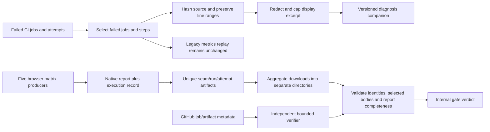

<user_constraints>
## User Constraints (from CONTEXT.md)

## Implementation Decisions

### Select failures from actual failed execution

- **D-01:** Preserve every Phase 252 artifact byte-for-byte. Add an explicitly versioned Phase 253 diagnosis path and companion correction record. Its records must identify the original archive/report hashes, analyzer source, run/attempt/job/step, original outcome, corrected diagnosis and missing details. Preserve the legacy baseline replay contract: its verifier compares the complete replay object. Do not silently change old failure fields or turn historical failures green.
- **D-02:** Reject the shortlist's `settled-findings-lint` Test D as a failure signature. Both cited PR logs show that test passing. Their actual fast-check failure was the metrics self-test's Test Z dependency on an unavailable historical archive; current source already replaced that dependency with a hermetic contract. Verify the present test and retain the old reds; do not repair a passing settled-findings test again.
- **D-03:** Select admin-eval registration as the first current investigation lead. Retained runs 38139851334, 38141796613 and 38205503164 contain registration failures. The latest nightly's `admin-eval.spec.ts` Git blob is identical to current source. Its failure occurred in `admin-eval-dark`, so investigate desktop Chromium, WebKit/mobile and dark Chromium. A recurring timeout and an unchanged helper establish a lead, not its cause or a completed flake fix.
- **D-04:** Before fixing anything, reproduce a specific readiness, transport, state/order or harness condition on the exact affected source with the pinned tools. Preserve before/after results and a negative control that detects the regression. The existing helper already waits for LiveView connection and captures registration diagnostics. Do not assume the old September explanation still applies, lengthen timeouts speculatively, replace registration with shared authentication, or change product authentication. If the cause lies outside the test/CI boundary, record it and keep independent gate work moving.
- **D-05:** Prefer native Playwright results and the actual failing job/step/command over whole-log keyword matching. For shell output, a passing banner or an intentional negative-test `FAIL:` is not an unexpected failure. Keep observed result, suspected cause and proved cause separate. Preserve expected versus actual test status, original nonzero exits, earlier attempts and producer failures behind aggregates. Timeout is not automatically infrastructure; rerun count does not prove superseded cancellation.
- **D-06:** Record diagnosis completeness per failed producer job and selected step. The current archive often retains only one failed-job log, and some failed jobs remain unexplained. Select relevant failure context before the existing redaction/display cap; retain original hashes, line ranges and truncation metadata. Missing, clipped, conflicting or hash-mismatched inputs remain unknown. A bounded collection limit or unavailable log must not become proof that there is no flake.

### Deterministic readiness, state isolation and diagnostics

- **D-07:** Preserve five browser seams, their existing selected specs/projects, separate databases/apps/ports, `workers: 1`, `fullyParallel: false` and `retries: 0`. Keep one ordinary `MIX_ENV=test mix ci` library owner. Browser runs use a real `MIX_ENV=dev` application/database; ExUnit uses Sandbox owners. Do not describe browser state as Sandbox-isolated or random identifiers as proof of database isolation.
- **D-08:** Use application readiness conditions before interaction: actual HTTP readiness at boot, LiveView connection for LiveView routes, and server-confirmed registration outcomes. Controller login pages must not wait for a LiveView marker. Test controlled delayed/missing readiness with explicit signals and a broken-wait negative control, then establish the relevant behavior through the real browser/server. Preserve bounded condition polling at boot; add no fixed test sleeps, retry wrappers or `test.slow` masking. Do not infer the observed transport from comments about long-poll fallback.
- **D-09:** Verify the affected state boundary with a deliberate collision/isolation control and rollback/ownership checks where applicable. Preserve Ecto's existing owner lifecycle, explicit allowances for collaborating async processes, and shared mode only for non-async tests. Supervise test-owned processes. Keep isolated and preceding-order reproductions distinct: a fresh isolated pass cannot exclude an order-dependent failure.
- **D-10:** Capture first-failure traces for the selected diagnostic/repeat invocations with `--trace=retain-on-failure`, beginning before navigation and submission. Current global `on-first-retry` produces no trace with zero retries. Keep this override scoped; global recording cost has not been measured. Verify a deliberately failing test retains useful actions and its original assertion, while a passing control discards the trace. Use synthetic accounts, safe structural diagnostics and bounded CI artifact retention; exclude auth-state files, secrets and public Pages publication.
- **D-11:** Preflight the exact checkout SHA/cleanliness, workflow/source identities and command-observed tools. Restore the lockfile-installed Playwright 1.59.1 in the execution checkout before collecting evidence: ignored local `node_modules` currently contains 1.62.1. Confirm each host's actual Ecto/LiveView versions rather than using the library lockfile for the example app. Keep source, PR head, merge checkout and fixture workflow identities separate.

### Complete required-check ownership and honest skips

- **D-12:** Preserve the five effective required names: `Library tests`, `Example unit smoke (ExUnit + ConnTest)`, `Install smoke (fresh phx.new + sigra.install)`, `Example HTTP smoke (boot + curl critical routes)`, and `Example Playwright smoke (full lifecycle)`. Freshly read effective rules and check sources before hosted work. Unexpected changes produce a contract diagnostic; do not mutate protection rules or make `ci-gate` a sixth required name. No redundant check removal is proposed.
- **D-13:** Add `example_unit_smoke` to the internal `ci-gate` dependency/result/verdict ownership together, including the fixed lane-set tests and explanatory notes. Its independent required check does not close the internal release-gate omission. Reuse `honest-skip-verdict.sh` and existing tests; do not create a competing gate policy.
- **D-14:** Require the browser aggregate to account for exactly five producers and their selected bodies: `non_admin_smoke`, `admin_behavior`, `admin_checkpoints`, `design_gallery`, `demo_showcase`. Keep native successful matrix results necessary. Add small per-seam execution records using existing artifact actions and a standard-library validator. Records include selected step IDs, pre/post-`continue-on-error` outcomes and actual source/run/attempt/event/seam. Every selected full-workload browser body must supply its expected native report with complete, nonempty results matching the expected project/test selection; only documented docs-only body skips are exempt. Reject missing, duplicate, unknown, malformed, wrong-run/attempt/source records, skipped full-workload bodies and cancelled producers. A record cannot override a failed native job or prove tests ran when the native report is absent/empty/incomplete.
- **D-15:** Use unique artifact names containing seam/run/attempt, require the expected record file, and keep downloaded producer directories separate. Ordinary same-run validation needs no broad new token permission or per-job GitHub API polling. Do not merge matrix children into a shared output key: the last finishing job overwrites it. Distinct per-seam outputs are a lighter runner-up only if hosted proof establishes their complete terminal behavior; the chosen default is retained execution records.
- **D-16:** Accept intentional docs-only body skips only for an actual PR with a successful classifier and exactly `true`. Unknown classification runs full work or leaves a non-green result. Always account for all five producers; the terminal browser aggregate has no docs-only skip. Correct the manifest's synthetic aggregate entry, document the actual selected body boundaries, and update p10/p21/MAINTAINING parity with a negative fixture for this exact mismatch. Do not lower populated-inventory guards merely to pass.
- **D-17:** Preserve native command exits, matrix `fail-fast: false`, real cancellations and useful coverage owners. Add no `continue-on-error`. Use cancellation-resistant conditions narrowly for bounded result recording/verdicts, not expensive boot. Inject failed commands, cancelled work, missing jobs/records, unexpected skips, malformed identity, false classifier claims, and ownership/manifest drift. Expected negative probes are successful verification only when their source run actually fails/cancels and a separate verifier proves that expected result.
- **D-18:** For hosted phase evidence, independently compare retained GitHub jobs/steps and artifact metadata/digests with the producing run, attempt, source and workflow. Filename/JSON claims alone cannot establish origin. Operational same-run coverage records protect against accidental omission; they are not an attestation against an arbitrary malicious rewrite of a PR workflow. Preserve read-only ordinary CI permissions and existing action pins.

### Fixed verification budget and delivery boundaries

- **D-19:** Freeze at most three investigated signatures, their selected tests/projects/order, seeds, source identities and stop conditions before observing results. First reuse the saved archive. Additional selected diagnostics are capped at 60 HTTP requests or 15 minutes, including retries/redirects. Reproduction is capped at ten targeted invocations or twenty minutes per signature, sixty minutes total. Stop and diagnose deterministic failures; retain every attempt. One independently diagnosed infrastructure retry stays inside the relevant budget and never replaces the original result.
- **D-20:** After a demonstrated cause is fixed, run three fresh targeted invocations per affected project, plus the deterministic regression and negative controls. For relevant narrow ExUnit checks use three fixed seeds in separate processes (default 101/202/303), preserving normal scheduling/timeouts. Freeze these selections before starting. Use separate fresh app/database/context invocations for acceptance repeats; `--repeat-each` alone does not reset backend state. Run each existing browser seam selection once for integration coverage, and normal affected library/contracts, rather than fifteen full-seam repeats. Three passes prove those executions, not absence of flakiness. No unbounded retry-until-green or repeat-until-failure acceptance loop.
- **D-21:** Preflight and use the already registered `.github/workflows/ci.yml` path on a sealed scoped fixture ref for the lightweight hosted canary. On that fixture ref only, use the distinct workflow name `Phase 253 Gate Canary`, dispatch-only triggering, five tiny producers, candidate gate/record helpers, strict fixture identity checks, and a separate verifier mode. No default-branch mutation, release tag, recapture, issue notification, publishing credential or auto-merge is needed. Confirm downstream workflow-name triggers do not match before dispatch. Pin the tested helper checkout to the candidate commit and separately record fixture workflow SHA/blob; do not present fixture topology as production CI.
- **D-22:** The canary has six scenarios: full pass, intentional docs-only fixture, actual failed body, missing seam, unexpected body skip and actual run cancellation. Allow at most one infrastructure-only rerun, 45 lightweight job executions, sixty minutes and 120 GitHub requests. Reserve one separate verifier job inside the ceiling; six six-job scenarios plus a six-job rerun and verifier are at most 43 jobs. Cancellation targets only the positively identified fixture run/ref/SHA. The PR docs-only scenario is explicitly synthetic: record the real `workflow_dispatch` event alongside its logical PR input. Push/schedule/dispatch must not obtain the production docs-only exemption.
- **D-23:** Follow the canary with one normal production `pull_request` CI family for the exact candidate PR head, plus at most one diagnosed infrastructure rerun if necessary. Record both that head and the actual tested checkout/workflow revision (which can be a distinct GitHub merge commit); validate check status against the correct PR/merge revision without claiming the checkout equals the head. Preserve all outcomes and existing job timeout ceilings. Reuse its integration coverage where it meets D-20 rather than running duplicate full suites. Freeze a separate finite collection budget before launch, no larger than 120 requests/60 minutes. Dispatch canaries do not satisfy PR required checks or prove real PR classification. Keep real PR required-check proof and offline classifier controls separate; add a real docs-only PR probe only if changed classification behavior requires it, reserved within this same budget before outcomes.
- **D-24:** Completion needs proven selected fixes or the roadmap's honest no-flake path with adequate reviewed diagnostics and passing deterministic readiness/isolation controls. Recent unresolved registration failures, missing selected diagnostics or an exhausted reproduction budget cannot automatically qualify as no flake. Record `not_reproduced`, `diagnosis_incomplete`, target failures and requirement gaps honestly. No human UAT or old release record is a substitute. Honor one watcher per run, 60-second polling, core-budget stop at 250 and hard 403/429/reset handling. This discussion authorizes planning choices; no phase acceptance or optimization result is claimed.

### Agent's Discretion

Choose small internal helper/schema/file boundaries, exact signal-driven fixtures, targeted test names/seeds/order within the frozen limits, and safe artifact storage. Reuse Bash/Node/Python standard libraries, existing native reporters, gates and artifact actions. The failure selection, preserved baseline, required names, isolation/retry rules, proof boundaries and numeric ceilings above are locked. Research current pinned APIs before using a new fixture capability. A materially changed public/security/generated-host contract requires a separate decision; routine internal implementation choices do not.

### Folded Todos

The already-linked `2026-09-15-admin-eval-webkit-registration-flake-recurrence.md` is investigated through current source/logs; its title and suggested fixes are not conclusions. The unit-owner omission and `2026-09-19-example-playwright-smoke-manifest-step-gate-inaccuracy.md` are directly within CIREL-02's ownership/skip proof. Neither is closed by discussion. Other keyword matches remain unpromoted and unchanged.

## Deferred Ideas

- Auth-state reuse, higher worker counts, changed shard topology, cache/boot optimization, or removed coverage: Phase 254 only with measurements and ownership proof.
- Full contributor runbook, broad failure-report polish and final speed/reliability comparison: Phase 255.
- Public authentication/generator changes, product UI design, external flake platforms, broad upgrades, paid runners, releases and historical release-record recovery: outside this phase.
- Unexplained unselected failed producer jobs remain disclosed. Do not open a broad new history acquisition or unrelated backlog sweep to make the phase exhaustive.

### Reviewed Todos (not folded)

Per-shard parallelization belongs to optimization; timing orphan history already has prior ownership; unrelated installer, auth, release and planning keyword matches remain unchanged. The missing 1.6 upgrade guide remains its separate task. Discussion closes no todo or requirement.
</user_constraints>

<canonical_refs>
## Canonical References

**Downstream agents MUST read these before planning or implementing.**

### Scope, decisions and preserved source

- `.planning/ROADMAP.md`, `.planning/REQUIREMENTS.md`, `.planning/PROJECT.md`, `.planning/METHODOLOGY.md`, `AGENTS.md`, `test/example/AGENTS.md`.
- `.planning/phases/252-measure-current-ci/252-CONTEXT.md`.
- `.planning/phases/252-measure-current-ci/252-BASELINE.md` and `.planning/phases/252-measure-current-ci/252-BASELINE.json`.
- `.planning/phases/252-measure-current-ci/252-CI-SOURCE-BUNDLE.tar.gz` and `.planning/phases/252-measure-current-ci/252-COMPARISON-CONTRACT.json`.
- `.planning/phases/252-measure-current-ci/252-VALIDATION.md` and `.planning/phases/252-measure-current-ci/252-VERIFICATION.md`.
- `.planning/phases/253-fix-flaky-ci-and-preserve-required-checks/253-DISCOVERY.json` — source identities, corrected leads and limits; discussion discovery, not acceptance.
- `.planning/milestones/v1.48-phases/236-flake-root-cause-reproduce-name-fix/236-CONTEXT.md` and `.planning/milestones/v1.47-phases/232-playwright-economics-authenticate-once-then-shard/232-CONTEXT.md` — existing readiness and state ownership.

### Current CI and test seams

- `.github/workflows/ci.yml`, `.github/actions/example-playwright-boot/action.yml`, `.github/ci-skip-manifest.tsv`, `MAINTAINING.md`.
- `scripts/ci/honest-skip-verdict.sh`, `scripts/ci/honest-skip-verdict.test.sh`, `scripts/ci/wait-for-ci-gate.sh`.
- `scripts/ci/prohibitions/p10-no-undocumented-demotion.test.mjs`, `scripts/ci/prohibitions/p17-no-playwright-retry-wrapper.test.mjs`, `scripts/ci/prohibitions/p21-honest-skip-parity.test.mjs`.
- `scripts/ci/ci-run-metrics.sh`, `scripts/ci/ci-run-metrics.test.sh`, `scripts/ci/ci_metrics_security.py`, `scripts/ci/ci-playwright-report.mjs`.
- `test/example/priv/playwright/playwright.config.ts`, `test/example/priv/playwright/package-lock.json`, `test/example/priv/playwright/tests/admin-eval.spec.ts`, `test/example/priv/playwright/helpers/adminFlows.ts`.
- `mix.exs`, `mix.lock`, `test/support/postgres_case.ex`, `test/test_helper.exs`, `test/example/mix.lock`, `test/example/test/support/data_case.ex`.
- `.github/workflows/ci-observe.yml`, `.github/workflows/release-pr-automerge.yml`, `.github/workflows/release-run-observer.yml` — fixture dispatch must not trigger production observers.
- `.planning/todos/pending/2026-09-15-admin-eval-webkit-registration-flake-recurrence.md`, `.planning/todos/pending/2026-09-19-example-playwright-smoke-manifest-step-gate-inaccuracy.md`, `.planning/todos/pending/2026-07-29-example-unit-smoke-required-but-absent-from-ci-gate-needs.md` — diagnostic leads, not completed fixes.

### Project research and official documentation

- `prompts/elixir-oss-lib-ci-cd-best-practices-deep-research.md`, `prompts/elixir-opensource-libs-best-practices-deep-research.md`, `prompts/ecto-best-practices-deep-research.md`, `prompts/phoenix-live-view-best-practices-deep-research.md`, `prompts/Phoenix Auth Library — Jobs to Be Done, Personas & User Flows.md`.
- [GitHub required-check troubleshooting](https://docs.github.com/en/pull-requests/how-tos/merge-and-close-pull-requests/troubleshooting-required-status-checks), [matrix output semantics](https://docs.github.com/en/actions/reference/workflows-and-actions/workflow-syntax#using-job-outputs-in-a-matrix-job), [step outcomes](https://docs.github.com/en/actions/reference/workflows-and-actions/contexts#steps-context), [cancellation](https://docs.github.com/en/actions/reference/workflows-and-actions/workflow-cancellation).
- [Workflow dispatch](https://docs.github.com/en/actions/reference/workflows-and-actions/events-that-trigger-workflows#workflow_dispatch), [dispatch API](https://docs.github.com/en/rest/actions/workflows#create-a-workflow-dispatch-event), [attempt jobs](https://docs.github.com/en/rest/actions/workflow-jobs#list-jobs-for-a-workflow-run-attempt), [artifact origin fields](https://docs.github.com/en/rest/actions/artifacts#get-an-artifact), [upload](https://github.com/actions/upload-artifact#not-uploading-to-the-same-artifact), [download](https://github.com/actions/download-artifact#usage).
- [Playwright traces](https://playwright.dev/docs/trace-viewer#tracing-on-ci), [1.59.1 trace implementation](https://github.com/microsoft/playwright/blob/v1.59.1/packages/playwright/src/worker/testTracing.ts), [hydration](https://playwright.dev/docs/navigations#hydration), [authentication state](https://playwright.dev/docs/auth#basic-shared-account-in-all-tests), [JSON reporter](https://playwright.dev/docs/test-reporters#json-reporter), [test result](https://playwright.dev/docs/api/class-testresult).
- [Example LiveView 1.1.28 lifecycle](https://phoenix-live-view.hexdocs.pm/1.1.28/Phoenix.LiveView.html#c:mount/3), [example Sandbox 3.13.5 source](https://github.com/elixir-ecto/ecto_sql/blob/v3.13.5/lib/ecto/adapters/sql/sandbox.ex), [library Sandbox 3.14.0](https://hexdocs.pm/ecto_sql/3.14.0/Ecto.Adapters.SQL.Sandbox.html), [Mix 1.19.5 test options](https://github.com/elixir-lang/elixir/blob/v1.19.5/lib/mix/lib/mix/tasks/test.ex), [Chromium order investigation](https://www.chromium.org/developers/testing/fixing-flaky-tests/fixing_flaky_unittests/).
</canonical_refs>

<phase_requirements>
## Phase Requirements

| ID | Description | Research Support |
|----|-------------|------------------|
| CIREL-01 | The flaky failures selected from current measurements are reproduced and fixed with deterministic regression checks and repeat runs, without increasing blanket retries or replacing readiness with sleeps. | D-02–D11 define the selected evidence, pinned reproduction, readiness/isolation controls, trace capture, and bounded repeats. Source seams and test entrypoints below support the plan; the registration cause remains unknown pending reproduction. |
| CIREL-02 | Useful test coverage and required-check names remain intact; injected failures, cancellations, missing expected jobs, and unexpected skips still prevent a green required gate. Any proposed redundant-check removal needs a recorded coverage comparison before it is accepted. | D-12–D18 identify required names, internal gate ownership gap, browser producers, native report/body accounting, skip-manifest mismatch, and negative tests. No required-check removal is in scope. |
</phase_requirements>

# Phase 253: Fix Flaky CI and Preserve Required Checks - Research

**Researched:** 2026-10-12
**Domain:** GitHub Actions CI reliability, Playwright/LiveView diagnosis, and required-check integrity
**Confidence:** HIGH for opened repository seams and official API behavior; LOW for un-reproduced registration cause and hosted behavior not yet probed

## Summary

Plan two parallel tracks: reproduce the selected admin registration failure on the exact affected checkout with pinned tools, and close deterministic required-gate accounting gaps with local contract tests. The current evidence identifies registration as a lead, not a root cause. Preserve original failing runs and source identities; only a reproduced condition on current pinned sources justifies a test or CI fix. [VERIFIED: .planning/phases/253-fix-flaky-ci-and-preserve-required-checks/253-CONTEXT.md:25-35]

Keep the Phase 252 replay object byte-for-byte compatible. Its verifier compares the complete replay object, so add diagnosis in a separate explicitly versioned companion record and leave old metrics fields and historical results alone. The collector currently keeps only one failed job log in a common path and sanitizes/truncates after collection; Phase 253 should select relevant failed-step context first, then redact and cap displayed excerpts while recording hashes, line ranges, truncation and per-producer completeness. [VERIFIED: scripts/ci/ci-run-metrics.sh:727-770,1743-1780; scripts/ci/ci_metrics_security.py:405-435]

For gate work, reuse the existing internal verdict and skip parity tests. Add the independently required unit-smoke job to internal gate dependency/result ownership; require complete native Playwright reports plus unique same-run records for all five seams; correct the manifest to describe body-level eligibility rather than suppressing the always-running aggregate. Keep local contract checks separate from real browser repeats, fixture canary evidence, and production PR checks. [VERIFIED: .github/workflows/ci.yml:762-775,1383-1421,1447-1553,1606-1632,1780-1790; .github/ci-skip-manifest.tsv:75]

**Primary recommendation:** Add a versioned diagnosis companion at the existing metrics CLI boundary, extend the current gate/verdict and skip-manifest contracts, and use a small standard-library validator for per-seam records and native report completeness. First reproduce registration with lockfile-pinned Playwright and scoped retained-on-failure trace; do not assume a cause.

## Architectural Responsibility Map

| Capability | Primary Tier | Secondary Tier | Rationale |
|------------|-------------|----------------|-----------|
| Failure collection and diagnosis | CI runner/scripts | Artifact storage | Runner owns workflow outcomes; scripts select logs and write bounded, redacted records. |
| Required internal gate verdict | GitHub Actions workflow | Shell validator | Workflow owns native job results; existing verdict helper owns internal lane decision. |
| Browser body execution accounting | CI runner/browser process | Artifact storage | Each matrix job knows its body and report; artifacts carry records to aggregate. |
| Registration readiness and reproduction | Example app/Playwright | CI runner | App provides readiness and registration response; browser drives the real flow. |
| PR/fixture evidence identity | GitHub Actions/GitHub API | Local verifier | Hosted metadata establishes run, attempt, source and workflow identity. |

## Standard Stack

No new package is needed. Use shell, Python/Node standard libraries, GitHub Actions primitives, Playwright native JSON output, and already pinned upload/download actions, consistent with the locked no-new-dependency choice. [VERIFIED: .planning/phases/253-fix-flaky-ci-and-preserve-required-checks/253-CONTEXT.md:92-119]

### Core

| Tool or component | Version / identity | Purpose | Why use it |
|---------|---------|---------|--------------|
| Existing metrics CLI and Python sanitizer | Repository source | Preserve legacy replay; add separate diagnosis | Existing collection, hashing, sanitization and replay boundaries. [VERIFIED: scripts/ci/ci-run-metrics.sh:645-770,1660-1693,1743-1780; scripts/ci/ci_metrics_security.py:405-435] |
| Existing honest-skip verdict | Repository source | Internal required-lane decision | Extend its ownership and tests rather than create a competing gate. [VERIFIED: scripts/ci/honest-skip-verdict.sh:101-112,223-227] |
| GitHub Actions workflow and artifact actions | Existing workflow pins | Native jobs, records and aggregate evidence | Workflow already has five browser producers and artifact handling. [VERIFIED: .github/workflows/ci.yml:1383-1421,1447-1553] |
| Playwright Test and JSON reporter | Example lockfile 1.59.1 | Browser execution and structured report | Lockfile pins 1.59.1; ignored local installation reports 1.62.1, so restore from lock before evidence collection. [VERIFIED: test/example/priv/playwright/package-lock.json:121-135; local command returned 1.62.1] |
| Example app Ecto and LiveView | Example lock: Ecto SQL 3.13.5; LiveView 1.1.28 | Registration/database boundary | Root library lock differs; record actual example host versions at execution preflight. [VERIFIED: test/example/mix.lock:15,42; mix.lock:19,49] |

### Supporting

| Tool | Purpose | When to use |
|------|---------|-------------|
| Bash tests with fake gh | Offline collector and verdict contracts | Fast checks without GitHub API credentials. [VERIFIED: scripts/ci/ci-run-metrics.test.sh; scripts/ci/honest-skip-verdict.test.sh] |
| Node built-in test runner | Offline workflow and manifest contracts | p10 and p21 parity checks. [VERIFIED: scripts/ci/prohibitions/p10-no-undocumented-demotion.test.mjs; scripts/ci/prohibitions/p21-honest-skip-parity.test.mjs] |
| Playwright JSON reporter | Native report and selected test/project accounting | Require report from each selected full-workload browser body. [CITED: https://playwright.dev/docs/test-reporters#json-reporter] |
| Playwright retain-on-failure trace | Scoped first-failure diagnosis | Only selected diagnostic/repeat runs; global on-first-retry produces no trace at zero retries. [CITED: https://playwright.dev/docs/trace-viewer#tracing-on-ci] |
| GitHub job-attempt and artifact metadata | Independent hosted verification | Bounded post-run compare of GitHub metadata to run, attempt, source and workflow. [CITED: https://docs.github.com/en/rest/actions/workflow-jobs#list-jobs-for-a-workflow-run-attempt; https://docs.github.com/en/rest/actions/artifacts#get-an-artifact] |

### Alternatives Considered

| Instead of | Could use | Tradeoff |
|------------|-----------|----------|
| Versioned diagnosis companion | Add Phase 253 keys to legacy replay | Conflicts with complete-object equality and immutable Phase 252 inputs. |
| Per-seam artifacts and validator | One shared matrix output key | GitHub says the last matrix job to finish overwrites an identical output key. [CITED: https://docs.github.com/en/actions/reference/workflows-and-actions/workflow-syntax#using-job-outputs-in-a-matrix-job] |
| Existing verdict helper | New gate policy | Duplicates policy and creates lane-set drift. |
| Scoped retained traces | Global tracing or retries | Broadens volume or changes retry semantics despite locked zero-retry behavior. |

**Installation:** None.

**Version verification:** No package registry lookup is needed because this phase adds no package. The lockfile contains the verbatim entries `"version": "1.59.1"` and `"playwright": "1.59.1"` at lines 121-135. Local ignored node_modules reports 1.62.1. Restore the lockfile installation in the execution checkout. [VERIFIED: test/example/priv/playwright/package-lock.json:121-135]

## Architecture Patterns

### System Architecture Diagram



### Recommended Project Structure

Reuse current locations and keep new boundaries small:

- scripts/ci/ci-run-metrics.sh — versioned diagnosis CLI surface; preserve replay mode.
- scripts/ci/ci_metrics_security.py — safe excerpt/redaction primitives.
- scripts/ci/honest-skip-verdict.sh and its test — unit-smoke lane ownership and failures.
- p10 and p21 prohibition tests — workflow/manifest parity.
- .github/workflows/ci.yml — producer records, artifact identity, aggregate validation and gate needs.
- .github/ci-skip-manifest.tsv and MAINTAINING.md — correct body boundaries and parity documentation.
- A small validator and tests may live under scripts/ci; exact path/schema is an implementation choice.

### Pattern 1: Preserve replay; version diagnosis separately

**What:** The current verifier compares complete baseline and replay objects. Keep that comparison unchanged and write diagnosis to an independent versioned companion. Bind it to hashes of the original archive/report, analyzer identity, run/attempt/job/step, original outcome, corrected diagnosis and missing details. [VERIFIED: scripts/ci/ci-run-metrics.sh:1743-1780]

**Example shape only:**

```json
{
  "schema_version": 1,
  "source": {
    "archive_sha256": "computed from preserved archive",
    "report_sha256": "computed from preserved report",
    "analyzer": "source path and revision"
  },
  "producer": {
    "run_id": "observed run",
    "attempt": 1,
    "job_id": "observed job",
    "step_id": "observed step",
    "outcome": "observed native outcome"
  },
  "diagnosis": {
    "status": "proposed status",
    "corrected_category": "evidence-backed category or unknown",
    "missing_details": []
  }
}
```

Field names and status vocabulary are proposed, not existing verified schema. [ASSUMED]

### Pattern 2: Select failure context before redaction and truncation

Enumerate every relevant failed/timed-out producer and selected step, extract bounded context around the actual error, preserve source hash and line range, then redact and cap displayed output. Record per-producer completeness. Missing, clipped, conflicting or hash-mismatched evidence remains unknown. Current collection selects a single failed job and the sanitizer caps initial input bytes. [VERIFIED: scripts/ci/ci-run-metrics.sh:727-770; scripts/ci/ci_metrics_security.py:405-435]

### Pattern 3: Account for every selected browser body

Each of the five producers should upload a unique record with seam/run/attempt and the expected Playwright native report for a full body. Record selected step identifiers, pre/post continue-on-error outcome, source SHA, run id, attempt, event and seam. Aggregate downloads each artifact into a separate directory and validates exact producer set, identity, body status and complete nonempty report selection. Native job failure always remains failure. Matrix shared outputs are unsafe because the last finishing child overwrites a duplicate key. [VERIFIED: .github/workflows/ci.yml:1383-1421,1447-1553; CITED: https://docs.github.com/en/actions/reference/workflows-and-actions/workflow-syntax#using-job-outputs-in-a-matrix-job; https://playwright.dev/docs/test-reporters#json-reporter]

### Pattern 4: Keep fixture, PR head and tested checkout distinct

For hosted evidence record PR head separately from merge checkout, source revision, workflow blob/SHA, run and attempt. Compare with GitHub job-attempt and artifact metadata. Fixture workflow_dispatch evidence does not prove production PR classification or satisfy required checks. [CITED: https://docs.github.com/en/rest/actions/workflow-jobs#list-jobs-for-a-workflow-run-attempt; https://docs.github.com/en/rest/actions/artifacts#get-an-artifact]

### Anti-Patterns to Avoid

- Whole-log keyword matching as sole cause detector.
- Selecting one failed job or truncating before extracting the failing section.
- Treating missing reports, logs, clipped excerpts or bounded searches as “no flake.”
- Adding a required-check name, changing protection rules or weakening native job results.
- Giving matrix children a shared output key.
- Treating artifact names or self-reported JSON as proof of workflow/source identity.
- Sleep-based readiness, blanket retries, shared browser auth state or claiming browser database isolation via Sandbox.

## Don't Hand-Roll

| Problem | Don't Build | Use Instead | Why |
|---------|-------------|-------------|-----|
| Browser result/project selection | Parse console banners | Native Playwright JSON reporter | Structured test/project results are already available. [CITED: https://playwright.dev/docs/test-reporters#json-reporter] |
| LiveView readiness | Fixed delay or arbitrary timeout increase | Existing connected marker and server-confirmed registration response | Existing helper waits for connection and captures POST/response. [VERIFIED: test/example/priv/playwright/tests/admin-eval.spec.ts:153-196] |
| Gate lane policy | Competing gate implementation | Existing honest-skip-verdict helper | Avoid divergent lane ownership. [VERIFIED: scripts/ci/honest-skip-verdict.sh:101-112,223-227] |
| Log redaction | New package | Existing sanitizer extended after context selection | Redaction and caps already exist. [VERIFIED: scripts/ci/ci_metrics_security.py:405-435] |
| Hosted provenance | Trust JSON/filename | GitHub job and artifact metadata | Independent fields permit origin comparison. [CITED: https://docs.github.com/en/rest/actions/workflow-jobs#list-jobs-for-a-workflow-run-attempt; https://docs.github.com/en/rest/actions/artifacts#get-an-artifact] |

**Key insight:** Keep the native command outcome, proof that the intended tests ran, and explanation for the failure as separate facts.

## Common Pitfalls

### Pitfall 1: Fixing the wrong signature

The shortlist's settled-findings lint Test D is rejected; cited logs show it passing. Current source already replaced the metrics self-test's unavailable historical archive dependency with a hermetic contract. Start from actual failed command and current source; retain historical reds. [VERIFIED: .planning/phases/253-fix-flaky-ci-and-preserve-required-checks/253-CONTEXT.md:25-35]

### Pitfall 2: Calling a recurring timeout a root cause

Retained failures and unchanged helper identify an investigation lead, not readiness, transport, state/order or harness cause. Use exact source, pinned tools, frozen project/order, scoped trace and a negative control. Do not lengthen waits speculatively or infer transport from comments. [VERIFIED: .planning/phases/253-fix-flaky-ci-and-preserve-required-checks/253-CONTEXT.md:28-35; CITED: https://playwright.dev/docs/trace-viewer#tracing-on-ci]

### Pitfall 3: Losing relevant output before diagnosis

Current collection chooses one failed job artifact; sanitizer takes a bounded initial prefix. Select failure context per producer/step before redaction/display cap; include hashes, line range and completeness. [VERIFIED: scripts/ci/ci-run-metrics.sh:727-770; scripts/ci/ci_metrics_security.py:405-435]

### Pitfall 4: Green gate with an unowned lane or skipped body

Internal ci-gate needs omit independently required example_unit_smoke, and aggregate job success alone does not prove all selected test bodies executed. Add lane to needs/result/verdict/fixed lane tests; require five producer records and complete native reports. [VERIFIED: .github/workflows/ci.yml:762-775,1780-1790]

### Pitfall 5: Manifest describes aggregate instead of body eligibility

The manifest has a docs-only condition on the terminal browser aggregate although that aggregate is always-run; document actual selected-body skip boundaries and add negative parity fixture. Keep all five producers accounted for and don’t weaken inventory guards. [VERIFIED: .github/ci-skip-manifest.tsv:75; .github/workflows/ci.yml:1606-1632]

### Pitfall 6: Confusing step outcome, conclusion and cancellation

GitHub exposes outcome before continue-on-error and conclusion after it; cancellation and skipped states are distinct. Record both values and actual run event/attempt/cancellation; separate verifier proves expected fixture outcomes. [CITED: https://docs.github.com/en/actions/reference/workflows-and-actions/contexts#steps-context; https://docs.github.com/en/actions/reference/workflows-and-actions/workflow-cancellation]

### Pitfall 7: Zero retries means no on-first-retry trace

Current browser config has retries zero and on-first-retry tracing, so selected first failures need scoped retain-on-failure mode. Verify failure trace retained and passing control discarded; do not broaden tracing globally. [VERIFIED: test/example/priv/playwright/playwright.config.ts:61-97; CITED: https://playwright.dev/docs/trace-viewer#tracing-on-ci]

### Pitfall 8: Using ignored or root-lock dependencies as evidence versions

Example Playwright lock pins 1.59.1 while ignored local installation reports 1.62.1. Example Mix lock has Ecto SQL 3.13.5 and LiveView 1.1.28; root lock differs. Restore and record actual host versions before reproduction. [VERIFIED: test/example/priv/playwright/package-lock.json:121-135; test/example/mix.lock:15,42; mix.lock:19,49]

## Code Examples

Existing fast contract commands, not executed during research:

```bash
bash scripts/ci/ci-run-metrics.test.sh
bash scripts/ci/honest-skip-verdict.test.sh
node --test scripts/ci/prohibitions/p10-no-undocumented-demotion.test.mjs scripts/ci/prohibitions/p21-honest-skip-parity.test.mjs
```

Scoped browser diagnostic invocation pattern; freeze exact existing spec/project selection from archived command before use. Restore lockfile Playwright and fresh app/database first. This is not a verified reproduction command. [CITED: https://playwright.dev/docs/trace-viewer#tracing-on-ci; VERIFIED: test/example/priv/playwright/package-lock.json:121-135]

```bash
npx playwright test <frozen-selected-spec-and-projects> --retries=0 --trace=retain-on-failure
```

Existing registration helper waits for document load and connected LiveView marker, and captures registration POST/response. Controller login helper is a different boundary and must not wait for LiveView marker. [VERIFIED: test/example/priv/playwright/tests/admin-eval.spec.ts:153-196,408-418; test/example/priv/playwright/helpers/adminFlows.ts:37-79; CITED: https://phoenix-live-view.hexdocs.pm/1.1.28/Phoenix.LiveView.html#c:mount/3]

```typescript
await page.waitForLoadState('domcontentloaded');
await page.locator('[data-phx-session].phx-connected').waitFor();
```

This illustrates the existing boundary only; new controls should prove delayed/missing readiness and a broken-wait negative control without sleeps.

## Project Constraints (from AGENTS.md)

- Use plain English; name the missing evidence and what would resolve it.
- For admin UI changes, follow guides/reference/admin-ui-principles.md and guides/reference/admin-design-contract.md; preserve sg-* cascade-layer/BEM, Rail Accent assets, and Light, Dark, and System modes.
- Keep Playwright/admin UI tests deterministic: role selectors, stable hooks, LiveView readiness, no sleeps.
- Within authorized work, prefer deterministic tests, browser automation, CI polling and machine-readable evidence over human UAT. Retry a transient failure once and diagnose deterministic failures; never waive missing evidence.
- Before rewriting dirty planning files, preserve exact path/status/bytes and verify read-back. Do not refresh dirty state/evidence before recovery is proven.
- At GSD stopping points, report the exact next command and distinguish implementation from phase verification; check next phase readiness before routing forward.
- Use one CI watcher per run and 60-second polling. Inspect REST core budget before a long watch; stop at 250 or fewer remaining, and stop on HTTP 403/429 until reset. [VERIFIED: AGENTS.md; test/example/AGENTS.md]
- In the example app, run `mix precommit` when implementation work is complete and fix pending issues; for app HTTP code use existing Req and avoid HTTPoison, Tesla and httpc. [VERIFIED: test/example/AGENTS.md]
- If a change reaches Phoenix/LiveView or HEEx templates, preserve the local v1.8 conventions: wrap views in `<Layouts.app ...>`, keep flash_group inside layouts.ex, pass current_scope through authenticated routes, use imported `<.icon>` and `<.input>` components, and retain their documented class/input behavior. [VERIFIED: test/example/AGENTS.md]
- If touching Elixir or app tests, follow the example guide: no index access on lists, bind block-expression results, do not nest modules, access structs directly and changesets with Ecto APIs, do not create atoms from user input, use predicate names ending in `?`, name OTP supervisors/registries, use back-pressured Task.async_stream, read mix task help, avoid deps.clean, supervise test processes, and avoid Process.sleep/Process.alive? in tests. [VERIFIED: test/example/AGENTS.md]
- If changing Phoenix routes, account for scope aliases and do not use Phoenix.View. If changing Ecto/templates, preload associations used in templates; use string schema fields, avoid validate_number allow_nil, do not cast programmatic fields, generate migrations through mix ecto.gen.migration, use HEEx and Phoenix.Component forms, add stable DOM IDs, use cond instead of else-if, follow curly interpolation and class-list rules, and use HEEx comments. [VERIFIED: test/example/AGENTS.md]

## Validation Architecture

### Test Framework

| Property | Value |
|----------|-------|
| Framework | Bash contract scripts, Node built-in test runner, project Mix/ExUnit and Playwright integration |
| Config file | Existing test scripts, .github/workflows/ci.yml, and test/example/priv/playwright/playwright.config.ts |
| Quick run command | bash scripts/ci/honest-skip-verdict.test.sh |
| Full suite command | mix ci |

These are existing entrypoints; durations were not measured. Do not label mix ci, browser repeats or hosted probes as sub-30-second tests. [VERIFIED: mix.exs:144-160; scripts/ci/honest-skip-verdict.test.sh]

### Phase Requirements → Test Map

| Req ID | Behavior | Test Type | Automated Command | File Exists? |
|-------------|----------|-----------|-------------------|-------------|
| CIREL-01 | Per-producer failure extraction before redaction cap; missing/truncated context remains incomplete | shell contract | bash scripts/ci/ci-run-metrics.test.sh | Yes; extend |
| CIREL-01 | Registration condition reproduced with negative control on pinned source | Browser integration | Frozen Playwright selection with retries zero and retained trace | Existing spec/helper; controls to add |
| CIREL-01 | Demonstrated fix passes fresh targeted repeats for each affected project | Browser integration | Three fresh invocations per project within D-19/D-20 limits | Existing runner; run after proven fix |
| CIREL-02 | Internal gate rejects missing/failing/cancelled unit smoke | Shell contract | bash scripts/ci/honest-skip-verdict.test.sh | Yes; extend |
| CIREL-02 | Workflow/manifest parity covers body eligibility and negative fixture | Node contract | node --test scripts/ci/prohibitions/p10-no-undocumented-demotion.test.mjs scripts/ci/prohibitions/p21-honest-skip-parity.test.mjs | Yes; extend |
| CIREL-02 | Exactly five records plus complete native reports and correct identity | Unit contract then hosted fixture | New validator tests; then six-scenario D-21/D-22 canary | New tests required |
| CIREL-02 | Real required PR checks succeed on candidate identity | Hosted integration | Bounded normal pull_request CI family per D-23 | Hosted proof required |

### Sampling Rate

- Per task: run the relevant existing local Bash/Node contract command.
- Per wave: run all relevant contracts and affected narrow app/browser checks.
- Phase gate: normal project CI plus bounded hosted evidence checks; acceptance remains pending until a separate verifier checks evidence and requirements.

### Wave 0 Gaps

- [ ] Add tests for per-producer completeness, late failing-step extraction, hash mismatch and truncation.
- [ ] Add validator tests for missing/duplicate/unknown/malformed/wrong identity, unexpected skip, empty/incomplete/mismatched report and cancellation.
- [ ] Add signal-driven delayed/missing registration readiness and broken-wait negative controls.
- [ ] No framework or package installation required.

## Security Domain

Treat logs, JSON reports, artifacts and workflow fields as untrusted input. Validate types, allowed event/seam values, identity and bounded size before aggregation. Redact selected context before persisting human-readable excerpts; retain hashes and bounded source ranges without secrets. Use synthetic accounts and ensure traces do not include auth-state files or publish to Pages. Keep ordinary CI permissions read-only; same-run validation needs no broad token permission. [VERIFIED: .planning/phases/253-fix-flaky-ci-and-preserve-required-checks/253-CONTEXT.md:110-119; CITED: https://github.com/OWASP/ASVS/blob/master/5.0/docs_en/OWASP_Application_Security_Verification_Standard_5.0.0_en.xml]

### Applicable ASVS Categories

| ASVS Category | Applies | Standard Control |
|---------------|---------|-----------------|
| V2 Authentication | No product auth change | Keep auth contract untouched; use synthetic accounts in diagnostics. |
| V3 Session Management | No session change | Exclude auth-state files and session secrets from artifacts. |
| V4 Access Control | Limited hosted evidence permissions | Preserve read-only ordinary CI permissions; narrowly scope dispatch/cancel authority. |
| V5 File Handling | Yes | Validate artifact path, size, schema and expected files; use separate download directories. |
| V11 Cryptography | Limited | Use standard SHA-256 implementation; do not hand-roll cryptography. |
| V13 Configuration | Yes | Validate event, source/workflow identity and permissions; fail closed on unknown/conflicting claims. |
| V16 Security Logging and Error Handling | Yes | Redact bounded failure excerpts and never emit credentials/raw auth state. |

This is a Phase 253 security mapping, not a claim of full ASVS compliance. [CITED: https://github.com/OWASP/ASVS/blob/master/5.0/docs_en/OWASP_Application_Security_Verification_Standard_5.0.0_en.xml]

## Environment Availability

| Dependency | Required By | Available | Version | Fallback |
|------------|------------|-----------|---------|----------|
| Bash | Local contracts | Yes | 5.2.37 | — |
| Node/npm | Node contracts and Playwright restore | Yes | Node 26.10.0; npm 11.19.1 | — |
| Python 3 | Metrics contracts | Yes | 3.14.4 | — |
| Mix/Erlang | Example app/project checks | Yes | Present; capture exact versions at execution preflight | — |
| GitHub CLI | Hosted evidence | Yes | 2.101.0 | API client alternative only if authenticated |
| Local ignored Playwright | Browser diagnostics | Yes, wrong version | 1.62.1; lockfile 1.59.1 | Restore lockfile version in execution checkout |
| GitHub auth/API budget | Hosted canary and PR proof | Not checked by design | — | Preflight budget and credentials |

No application tests, GitHub API calls, CI dispatches or package installations were performed. Local availability does not prove hosted credentials, API budget or browser image identity.

## State of the Art

| Old approach | Current approach | When changed | Impact |
|--------------|------------------|--------------|--------|
| Trace only on first retry | Scoped retain-on-failure with retries still zero | Supported by current Playwright docs and pinned source | Captures selected first failures without retries. [CITED: https://playwright.dev/docs/trace-viewer#tracing-on-ci; https://github.com/microsoft/playwright/blob/v1.59.1/packages/playwright/src/worker/testTracing.ts] |
| Shared matrix output key | Unique per-seam record artifacts | GitHub matrix output semantics | Avoid last-completing child overwriting another output. [CITED: https://docs.github.com/en/actions/reference/workflows-and-actions/workflow-syntax#using-job-outputs-in-a-matrix-job] |
| Whole-log keyword classification | Native outcome and selected failure context per producer | Locked project decision | Keeps missing diagnosis visible rather than asserting no flake. [VERIFIED: .planning/phases/253-fix-flaky-ci-and-preserve-required-checks/253-CONTEXT.md:37-45] |

**Deprecated/outdated:**
- Global on-first-retry tracing as the only diagnostic capture for zero-retry runs: no retry occurs to trigger it. [VERIFIED: test/example/priv/playwright/playwright.config.ts:61-97]

## Assumptions Log

| # | Claim | Section | Risk if Wrong |
|---|-------|---------|---------------|
| A1 | A companion path/schema can fit the metrics CLI without conflicting with existing consumers. | Architecture Pattern 1 | Inspect readers before finalizing name and schema. |
| A2 | Existing artifact action pins support proposed per-seam files without permission/retention changes. | Pattern 3 | Verify exact action behavior in local contract and hosted canary. |
| A3 | A standard-library validator can consume required record/report data. | Standard Stack | Keep scope narrow and validate exact inputs. |
| A4 | Lockfile Playwright 1.59.1 is intended for reproduction. | Standard Stack | Archived browser image/tool identity may differ; record both. |

## Open Questions

1. **What causes the current admin registration failure?**
   - What we know: retained runs identify registration failures; current helper is unchanged; source history identifies browser/platform leads.
   - What's unclear: readiness, transport, state/order or harness cause on exact current source.
   - Recommendation: early bounded reproduction with pinned tools, frozen selection, signal-driven controls and scoped trace. This does not block planning.
2. **What are the actual hosted browser and example-app dependency versions?**
   - What we know: lockfiles pin Playwright and example Mix dependencies; local ignored Playwright differs.
   - What's unclear: archived hosted browser image and exact host runtime versions.
   - Recommendation: capture at D-11 preflight; do not substitute root lock values.
3. **Will the proposed records and reports survive dispatch and pull_request runs with correct identity?**
   - What we know: current workflow has per-seam jobs and artifact actions; local source reveals a manifest mismatch.
   - What's unclear: hosted artifact/job terminal behavior for proposed scenarios.
   - Recommendation: local contracts, then D-21/D-22 fixture canary within its budget, followed by separate D-23 production PR proof.

## Sources

### Primary (HIGH confidence)

- Repository source opened this session: 253-CONTEXT.md, REQUIREMENTS.md, ci.yml, ci-skip-manifest.tsv, metrics/gate/browser/test files cited inline.
- [Playwright trace viewer](https://playwright.dev/docs/trace-viewer#tracing-on-ci) — trace modes.
- [Playwright JSON reporter](https://playwright.dev/docs/test-reporters#json-reporter) — report output.
- [GitHub matrix outputs](https://docs.github.com/en/actions/reference/workflows-and-actions/workflow-syntax#using-job-outputs-in-a-matrix-job), [steps context](https://docs.github.com/en/actions/reference/workflows-and-actions/contexts#steps-context), [workflow cancellation](https://docs.github.com/en/actions/reference/workflows-and-actions/workflow-cancellation).
- [GitHub job attempts](https://docs.github.com/en/rest/actions/workflow-jobs#list-jobs-for-a-workflow-run-attempt), [artifact metadata](https://docs.github.com/en/rest/actions/artifacts#get-an-artifact), [workflow dispatch](https://docs.github.com/en/actions/reference/workflows-and-actions/events-that-trigger-workflows#workflow_dispatch).
- [Phoenix LiveView 1.1.28 lifecycle](https://phoenix-live-view.hexdocs.pm/1.1.28/Phoenix.LiveView.html#c:mount/3).
- [OWASP ASVS 5.0.0](https://github.com/OWASP/ASVS/blob/master/5.0/docs_en/OWASP_Application_Security_Verification_Standard_5.0.0_en.xml).

### Secondary (MEDIUM confidence)

- Local dependency lockfiles and CI action pins; exact values are quoted/cited inline.
- Project research artifacts listed in canonical references above.

### Tertiary (LOW confidence)

- No low-confidence package recommendations. Root-cause hypotheses remain unverified and are not presented as findings.

## Metadata

**Confidence breakdown:**
- Standard stack: HIGH — existing tooling/locks were read; official docs cover relevant APIs.
- Architecture: HIGH — workflow, gate, sanitizer and replay boundaries were opened; proposed helper/schema remains an implementation choice.
- Pitfalls: HIGH — based on current source and locked decisions; no root cause inferred from history.

**Research date:** 2026-10-12
**Valid until:** 30 days for repository boundaries; check official APIs and workflow behavior before implementation.


## Package Legitimacy Audit

Existing lockfile restoration only; this phase adds no package. The CLI check was run first; its unversioned lookup evaluated latest Playwright and reported `SUS: too-new`. The CLI exposes no version argument. The same exported `checkPackages` seam was therefore run against each exact locked version with real registry/clock/default thresholds; all eleven returned `OK`. The original latest-release result is retained and is not an override of a selected-version finding. [VERIFIED: /Users/jon/.codex/gsd-core/bin/lib/package-legitimacy.cjs:179-230,352-367; 253-PACKAGE-AUDIT.json]

Names come from the existing tracked package.json/lockfile; Playwright is additionally documented by [official installation docs](https://playwright.dev/docs/intro) and [pinned upstream source](https://github.com/microsoft/playwright/tree/v1.59.1). Registry metadata for the exact version and SHA-512 integrity matched the lockfile. `npm view <name>@<locked-version> version scripts.postinstall repository.url dist.integrity --json` observed no postinstall for these packages. The initial home-cache EPERM was resolved with a writable scoped temporary cache. No installation was performed. [VERIFIED: test/example/priv/playwright/package.json; test/example/priv/playwright/package-lock.json; 253-PACKAGE-AUDIT.json]

| Package (locked version) | Registry | Published | Weekly downloads | Source Repo | Verdict | Disposition |
|---|---|---|---|---|---|---|
| `@anthropic-ai/sdk@0.110.0` | npm | 2026-07-02T19:22:07.668Z | 46406759 | git+https://github.com/anthropics/anthropic-sdk-typescript.git | OK | Restore existing lock only |
| `@axe-core/playwright@4.11.2` | npm | 2026-04-17T13:27:17.386Z | 14099716 | git+https://github.com/dequelabs/axe-core-npm.git | OK | Restore existing lock only |
| `@playwright/test@1.59.1` | npm | 2026-04-01T17:59:00.155Z | 76192279 | git+https://github.com/microsoft/playwright.git | OK | Restore existing lock only |
| `@simplewebauthn/browser@13.3.0` | npm | 2026-03-10T05:55:51.036Z | 5333765 | git+https://github.com/MasterKale/SimpleWebAuthn.git | OK | Restore existing lock only |
| `cheerio@1.2.0` | npm | 2026-01-23T16:29:49.559Z | 27320678 | git://github.com/cheeriojs/cheerio.git | OK | Restore existing lock only |
| `otplib@12.0.1` | npm | 2020-01-24T17:18:40.248Z | 3802314 | git+https://github.com/yeojz/otplib.git | OK | Restore existing lock only |
| `parse5@8.0.1` | npm | 2026-04-19T20:16:16.612Z | 171448602 | git://github.com/inikulin/parse5.git | OK | Restore existing lock only |
| `zod@4.4.3` | npm | 2026-05-04T07:06:40.819Z | 346095287 | git+https://github.com/colinhacks/zod.git | OK | Restore existing lock only |
| `playwright@1.59.1` | npm | 2026-04-01T17:58:48.894Z | 113272409 | git+https://github.com/microsoft/playwright.git | OK | Restore existing lock only |
| `playwright-core@1.59.1` | npm | 2026-04-01T17:58:55.514Z | 125014934 | git+https://github.com/microsoft/playwright.git | OK | Restore existing lock only |
| `fsevents@2.3.2` | npm | 2021-02-05T14:46:33.925Z | 32181937 | git+https://github.com/fsevents/fsevents.git | OK | Restore existing lock only |

Packages removed due to SLOP: none. Selected locked packages flagged SUS: none. This audit covers the eight direct packages and Playwright runtime/optional dependency boundary, not a claim that all transitive packages are vulnerability-free. Existing lockfile integrity is preserved for the remainder. Recheck a changed lockfile before installation; no unpinned latest install is authorized.
